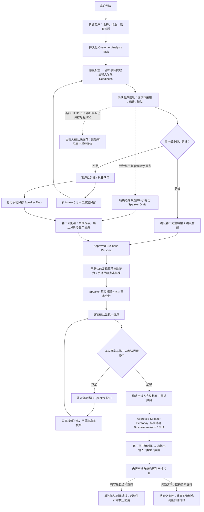

# Customer & Speaker Smart Intake UX V1.0 — Current Truth Audit

审计日期：2026-10-09（Asia/Shanghai）。性质：当前实现审计与本机离线证据，不是新产品方案批准、实施验收或 Production PASS。

**结论：现有系统已经具备同源客户提取与出镜人发现、客户未批准时保存出镜人草稿、两级人工审核、定向补缺和任务持久化；无需重建分析 Pipeline。但客户事实审核 HTTP 链路存在一个已复现 P0，已批准客户补充新版本也尚未打通。后续工作不能仅作为页面美化处理。**

## Baseline、范围与证据口径

| 项目 | 实际状态 |
|---|---|
| 仓库 / 主机 | `E:\projects\ai-video-ops` / `LIJIAN`，开发机；未连接或操作 4090 |
| HEAD | `f10f3992433ab81df38ae90f9379ce1061a7afac`，`main`，与用户冻结 RC 一致 |
| 开始时工作区 | `?? experiments/`；受版本控制文件没有差异。实验目录完整保留 |
| 本轮仓库修改 | 仅新增本审计报告；不修改应用、前端、测试、Schema、配置、Case 成果或治理文件 |
| 既有 8000 | 开始时 `127.0.0.1:8000`，PID `12400`，`/api/health` 返回 `{"status":"ok"}`。未用旧进程作为新 RC 页面证据，未向其业务 API 写入数据。意外中断后再次检查时已不监听；本轮没有重启该旧实例或执行其数据库迁移 |
| 页面审计节点 | 当前完整 ASGI 应用与当前静态文件；仅监听 `127.0.0.1:18009`；独立合成数据库与独立 Pipeline fixture root；四类 worker 全部关闭 |
| 隔离重启 | 中断前 PID `22568`；恢复后 PID `18240`，复用同一隔离数据库与 artifacts，未重新播种数据 |
| 收口时运行状态 | 已关闭本轮隔离审计进程 `18240`，复查 `8000/18009` 均无监听；所有隔离资料与证据保留。未启动或重启旧运行节点 |
| 数据边界 | 只在仓库外创建/操作合成测试资料、账户、任务和审批夹具；未读取或改写真实客户业务内容、运行数据库及 Production Authority。新建隔离库使用仓库已有 migrations，没有更改迁移文件或既有数据库 Schema |
| 模型与外部服务 | 零真实模型、Qiyun、GPU 或外部提供商调用。提取函数使用明确注入的合成返回值；不据此评价真实 AI 质量 |
| 外部证据目录 | [审计证据](E:/projects/ai-video-ops/.local/evidence/legacy-e-drive/customer-speaker-audit-20261009)，含脚本、隔离运行资料、截图与 JSON 轨迹；不纳入产品实现 |

已阅读根 AGENTS、[Operations Index](E:/projects/ai-video-ops/docs/operations/README.md)、适用 [RUNBOOK](E:/projects/ai-video-ops/docs/operations/RUNBOOK.md)、[Local Node guide](E:/projects/ai-video-ops/deploy/local-node/README.md)、[Authority Map](E:/projects/ai-video-ops/docs/operations/AUTHORITY_MAP_V1.md)、Console 说明及 [正式验证路线](E:/projects/ai-video-ops/tools/README.md)。FRP、云资源、凭证与 Production 部署不在本轮范围内。

证据分为：**浏览器/HTTP 实测**、**既有离线测试本次执行**、**代码确认**。截图中的名称、事实、身份、已批准状态均为合成夹具，不代表真实客户或真实模型产出。为了展示后续页面，部分客户审核状态由现有 canonical 离线函数建立；这不证明有缺陷的 HTTP 审核链路已通过。

## A. 当前端到端用户流程图

这张图区分了已存在的子能力与当前整合阻断。任务执行完成、逐项事实审核完成、完整档案批准和创作可执行是不同状态。

## B. 现有页面、桌面与手机截图

真实浏览器：Codex In-app Browser。桌面视口设置 `1440×1000`；手机设置 `390×844`（滚动条占宽时内容宽为 375）。以下是 **29 组页面/状态、58 张桌面与手机截图**；另有 10 张手机操作视口图，共 68 张。编号 01 桌面是视口图，其余成组截图主要为 full-page；手机操作图均是实际视口图，不能用 full-page 截图代替按钮可达性判断。

表内 `b`、`s`、`t` 分别表示客户、出镜人和任务 ID；具体合成 ID 见 [manifest](E:/projects/ai-video-ops/.local/evidence/legacy-e-drive/customer-speaker-audit-20261009/manifest.json)。实际 DOM 观察见 [browser-observations.json](E:/projects/ai-video-ops/.local/evidence/legacy-e-drive/customer-speaker-audit-20261009/browser-observations.json)。

| # | 现有路由 / 状态 | 页面主要行动 | 桌面 | 手机 |
|---|---|---|---|---|
| 01 | `/customers` | 新建客户；打开已有客户 | [图](E:/projects/ai-video-ops/.local/evidence/legacy-e-drive/customer-speaker-audit-20261009/screenshots/desktop-01-customers.jpg) | [图](E:/projects/ai-video-ops/.local/evidence/legacy-e-drive/customer-speaker-audit-20261009/screenshots/mobile-01-customers.jpg) |
| 02 | `/customers/new` | 分析客户信息 | [图](E:/projects/ai-video-ops/.local/evidence/legacy-e-drive/customer-speaker-audit-20261009/screenshots/desktop-02-customer-new.jpg) | [图](E:/projects/ai-video-ops/.local/evidence/legacy-e-drive/customer-speaker-audit-20261009/screenshots/mobile-02-customer-new.jpg) |
| 03 | `/customers/b`：事实待审核，含发现出镜人 | 逐项确认后“确认这些信息” | [图](E:/projects/ai-video-ops/.local/evidence/legacy-e-drive/customer-speaker-audit-20261009/screenshots/desktop-03-customer-facts.jpg) | [图](E:/projects/ai-video-ops/.local/evidence/legacy-e-drive/customer-speaker-audit-20261009/screenshots/mobile-03-customer-facts.jpg) |
| 04 | 同路由：客户档案待批准 | 确认客户档案 | [图](E:/projects/ai-video-ops/.local/evidence/legacy-e-drive/customer-speaker-audit-20261009/screenshots/desktop-04-customer-persona.jpg) | [图](E:/projects/ai-video-ops/.local/evidence/legacy-e-drive/customer-speaker-audit-20261009/screenshots/mobile-04-customer-persona.jpg) |
| 05 | 同路由：客户资料不足 | 补充缺失信息；并行添加出镜人 | [图](E:/projects/ai-video-ops/.local/evidence/legacy-e-drive/customer-speaker-audit-20261009/screenshots/desktop-05-customer-gaps.jpg) | [图](E:/projects/ai-video-ops/.local/evidence/legacy-e-drive/customer-speaker-audit-20261009/screenshots/mobile-05-customer-gaps.jpg) |
| 06 | `/customers/b/supplement` | 补充并继续；允许只填部分问题 | [图](E:/projects/ai-video-ops/.local/evidence/legacy-e-drive/customer-speaker-audit-20261009/screenshots/desktop-06-customer-supplement.jpg) | [图](E:/projects/ai-video-ops/.local/evidence/legacy-e-drive/customer-speaker-audit-20261009/screenshots/mobile-06-customer-supplement.jpg) |
| 07 | `/customers/b/edit` | 重新分析完整资料 | [图](E:/projects/ai-video-ops/.local/evidence/legacy-e-drive/customer-speaker-audit-20261009/screenshots/desktop-07-customer-edit.jpg) | [图](E:/projects/ai-video-ops/.local/evidence/legacy-e-drive/customer-speaker-audit-20261009/screenshots/mobile-07-customer-edit.jpg) |
| 08 | `/customers/b#overview`：已批准 | 开始创作；编辑资料 | [图](E:/projects/ai-video-ops/.local/evidence/legacy-e-drive/customer-speaker-audit-20261009/screenshots/desktop-08-customer-approved.jpg) | [图](E:/projects/ai-video-ops/.local/evidence/legacy-e-drive/customer-speaker-audit-20261009/screenshots/mobile-08-customer-approved.jpg) |
| 09 | `#profile` | 只读查看客户事实 | [图](E:/projects/ai-video-ops/.local/evidence/legacy-e-drive/customer-speaker-audit-20261009/screenshots/desktop-09-customer-profile.jpg) | [图](E:/projects/ai-video-ops/.local/evidence/legacy-e-drive/customer-speaker-audit-20261009/screenshots/mobile-09-customer-profile.jpg) |
| 10 | `#speakers` | 添加 / 打开出镜人 | [图](E:/projects/ai-video-ops/.local/evidence/legacy-e-drive/customer-speaker-audit-20261009/screenshots/desktop-10-customer-speakers.jpg) | [图](E:/projects/ai-video-ops/.local/evidence/legacy-e-drive/customer-speaker-audit-20261009/screenshots/mobile-10-customer-speakers.jpg) |
| 11 | `#content` | 已交付与当前内容空间概览 | [图](E:/projects/ai-video-ops/.local/evidence/legacy-e-drive/customer-speaker-audit-20261009/screenshots/desktop-11-customer-content.jpg) | [图](E:/projects/ai-video-ops/.local/evidence/legacy-e-drive/customer-speaker-audit-20261009/screenshots/mobile-11-customer-content.jpg) |
| 12 | `/customers/b`：分析中 | 查看后台进度，可离开 | [图](E:/projects/ai-video-ops/.local/evidence/legacy-e-drive/customer-speaker-audit-20261009/screenshots/desktop-12-customer-analyzing.jpg) | [图](E:/projects/ai-video-ops/.local/evidence/legacy-e-drive/customer-speaker-audit-20261009/screenshots/mobile-12-customer-analyzing.jpg) |
| 13 | 同路由：客户分析失败 | 继续分析；修改资料后重新分析 | [图](E:/projects/ai-video-ops/.local/evidence/legacy-e-drive/customer-speaker-audit-20261009/screenshots/desktop-13-customer-failed.jpg) | [图](E:/projects/ai-video-ops/.local/evidence/legacy-e-drive/customer-speaker-audit-20261009/screenshots/mobile-13-customer-failed.jpg) |
| 14 | `/customers/b/speakers/new`：客户已批准 | 分析出镜人信息 | [图](E:/projects/ai-video-ops/.local/evidence/legacy-e-drive/customer-speaker-audit-20261009/screenshots/desktop-14-speaker-new.jpg) | [图](E:/projects/ai-video-ops/.local/evidence/legacy-e-drive/customer-speaker-audit-20261009/screenshots/mobile-14-speaker-new.jpg) |
| 15 | 同路由：客户未批准 | 保存出镜人资料 | [图](E:/projects/ai-video-ops/.local/evidence/legacy-e-drive/customer-speaker-audit-20261009/screenshots/desktop-15-speaker-new-draft.jpg) | [图](E:/projects/ai-video-ops/.local/evidence/legacy-e-drive/customer-speaker-audit-20261009/screenshots/mobile-15-speaker-new-draft.jpg) |
| 16 | `/customers/b/speakers/s`：等待客户批准的草稿 | 继续客户档案 | [图](E:/projects/ai-video-ops/.local/evidence/legacy-e-drive/customer-speaker-audit-20261009/screenshots/desktop-16-speaker-pending.jpg) | [图](E:/projects/ai-video-ops/.local/evidence/legacy-e-drive/customer-speaker-audit-20261009/screenshots/mobile-16-speaker-pending.jpg) |
| 17 | 同路由：已保存、可分析 | 继续确认出镜人 | [图](E:/projects/ai-video-ops/.local/evidence/legacy-e-drive/customer-speaker-audit-20261009/screenshots/desktop-17-speaker-saved.jpg) | [图](E:/projects/ai-video-ops/.local/evidence/legacy-e-drive/customer-speaker-audit-20261009/screenshots/mobile-17-speaker-saved.jpg) |
| 18 | 同路由：出镜人事实待审核 | 确认这些信息 | [图](E:/projects/ai-video-ops/.local/evidence/legacy-e-drive/customer-speaker-audit-20261009/screenshots/desktop-18-speaker-facts.jpg) | [图](E:/projects/ai-video-ops/.local/evidence/legacy-e-drive/customer-speaker-audit-20261009/screenshots/mobile-18-speaker-facts.jpg) |
| 19 | 同路由：出镜人档案待批准 | 确认出镜人档案 | [图](E:/projects/ai-video-ops/.local/evidence/legacy-e-drive/customer-speaker-audit-20261009/screenshots/desktop-19-speaker-persona.jpg) | [图](E:/projects/ai-video-ops/.local/evidence/legacy-e-drive/customer-speaker-audit-20261009/screenshots/mobile-19-speaker-persona.jpg) |
| 20 | 同路由：出镜人已批准 | 只读查看；返回客户 | [图](E:/projects/ai-video-ops/.local/evidence/legacy-e-drive/customer-speaker-audit-20261009/screenshots/desktop-20-speaker-approved.jpg) | [图](E:/projects/ai-video-ops/.local/evidence/legacy-e-drive/customer-speaker-audit-20261009/screenshots/mobile-20-speaker-approved.jpg) |
| 21 | 同路由：出镜人资料不足 | 补充出镜人资料 | [图](E:/projects/ai-video-ops/.local/evidence/legacy-e-drive/customer-speaker-audit-20261009/screenshots/desktop-21-speaker-gaps.jpg) | [图](E:/projects/ai-video-ops/.local/evidence/legacy-e-drive/customer-speaker-audit-20261009/screenshots/mobile-21-speaker-gaps.jpg) |
| 22 | `/customers/b/speakers/s/supplement` | 提交补充资料 | [图](E:/projects/ai-video-ops/.local/evidence/legacy-e-drive/customer-speaker-audit-20261009/screenshots/desktop-22-speaker-supplement.jpg) | [图](E:/projects/ai-video-ops/.local/evidence/legacy-e-drive/customer-speaker-audit-20261009/screenshots/mobile-22-speaker-supplement.jpg) |
| 23 | `/customers/b/speakers/s`：分析中 | 查看进度 | [图](E:/projects/ai-video-ops/.local/evidence/legacy-e-drive/customer-speaker-audit-20261009/screenshots/desktop-23-speaker-analyzing.jpg) | [图](E:/projects/ai-video-ops/.local/evidence/legacy-e-drive/customer-speaker-audit-20261009/screenshots/mobile-23-speaker-analyzing.jpg) |
| 24 | 同路由：分析失败 | 仅提示返回客户，无直接重试 | [图](E:/projects/ai-video-ops/.local/evidence/legacy-e-drive/customer-speaker-audit-20261009/screenshots/desktop-24-speaker-failed.jpg) | [图](E:/projects/ai-video-ops/.local/evidence/legacy-e-drive/customer-speaker-audit-20261009/screenshots/mobile-24-speaker-failed.jpg) |
| 25 | `/tasks` | 任务 / 操作记录两个视图 | [图](E:/projects/ai-video-ops/.local/evidence/legacy-e-drive/customer-speaker-audit-20261009/screenshots/desktop-25-tasks.jpg) | [图](E:/projects/ai-video-ops/.local/evidence/legacy-e-drive/customer-speaker-audit-20261009/screenshots/mobile-25-tasks.jpg) |
| 26 | `/tasks/t`：客户任务 | 查看真实持久化状态 | [图](E:/projects/ai-video-ops/.local/evidence/legacy-e-drive/customer-speaker-audit-20261009/screenshots/desktop-26-customer-task.jpg) | [图](E:/projects/ai-video-ops/.local/evidence/legacy-e-drive/customer-speaker-audit-20261009/screenshots/mobile-26-customer-task.jpg) |
| 27 | `/tasks/t`：出镜人任务 | 查看真实持久化状态 | [图](E:/projects/ai-video-ops/.local/evidence/legacy-e-drive/customer-speaker-audit-20261009/screenshots/desktop-27-speaker-task.jpg) | [图](E:/projects/ai-video-ops/.local/evidence/legacy-e-drive/customer-speaker-audit-20261009/screenshots/mobile-27-speaker-task.jpg) |
| 28 | `/create?business_id=b` | 创作入口；图记录初始检查状态 | [图](E:/projects/ai-video-ops/.local/evidence/legacy-e-drive/customer-speaker-audit-20261009/screenshots/desktop-28-create.jpg) | [图](E:/projects/ai-video-ops/.local/evidence/legacy-e-drive/customer-speaker-audit-20261009/screenshots/mobile-28-create.jpg) |
| 29 | `/customers/b/supplement?gap=process_material` | 可选真实流程补充 | [图](E:/projects/ai-video-ops/.local/evidence/legacy-e-drive/customer-speaker-audit-20261009/screenshots/desktop-29-production-supplement.jpg) | [图](E:/projects/ai-video-ops/.local/evidence/legacy-e-drive/customer-speaker-audit-20261009/screenshots/mobile-29-production-supplement.jpg) |

### 手机实际操作观察

- 新建客户首屏不能看到提交按钮，需要纵向滚动；[首屏](E:/projects/ai-video-ops/.local/evidence/legacy-e-drive/customer-speaker-audit-20261009/screenshots/mobile-30-new-viewport-top.jpg)、[滚动后](E:/projects/ai-video-ops/.local/evidence/legacy-e-drive/customer-speaker-audit-20261009/screenshots/mobile-31-new-viewport-bottom.jpg)。滚动后按钮底边约 `600.55px`，底部导航顶边 `777px`，按钮可点击，无遮挡。
- 空输入实际点击后，HTTP 返回 422，页面只出现空红色 alert，缺少错误文字：[截图](E:/projects/ai-video-ops/.local/evidence/legacy-e-drive/customer-speaker-audit-20261009/screenshots/mobile-32-new-empty-error.jpg)。这不是必填校验缺失，而是错误投影缺失。
- 客户逐项确认并滚动至提交区：[提交前](E:/projects/ai-video-ops/.local/evidence/legacy-e-drive/customer-speaker-audit-20261009/screenshots/mobile-33-facts-before-submit.jpg)。按钮底边约 `648.84px`，导航顶边 `777px`，点击可达。点击后浏览器出现“请求失败，请稍后重试。”；[操作区截图](E:/projects/ai-video-ops/.local/evidence/legacy-e-drive/customer-speaker-audit-20261009/screenshots/mobile-34-customer-review-error.jpg)拍摄时瞬时 toast 已消失，不将该图片单独作为 HTTP 错误证明；HTTP 500 及持久化部分成功见下文 JSON 轨迹。
- 刷新后客户已进入档案待确认，出镜人草稿未生成：[部分成功状态](E:/projects/ai-video-ops/.local/evidence/legacy-e-drive/customer-speaker-audit-20261009/screenshots/mobile-35-error-refresh-partial-success.jpg)。这说明笼统“失败”不能代表写入完全回滚。
- 出镜人录入页滚动后按钮底边约 `581.63px`，导航顶边 `777px`：[实际视口](E:/projects/ai-video-ops/.local/evidence/legacy-e-drive/customer-speaker-audit-20261009/screenshots/mobile-36-speaker-new-bottom.jpg)。
- 手机实际提交合成客户后仍停留 `/customers/new`：[进度](E:/projects/ai-video-ops/.local/evidence/legacy-e-drive/customer-speaker-audit-20261009/screenshots/mobile-37-submit-progress.jpg)。刷新变回空表单：[刷新](E:/projects/ai-video-ops/.local/evidence/legacy-e-drive/customer-speaker-audit-20261009/screenshots/mobile-38-refresh-new-form.jpg)。通过客户列表打开同一记录可恢复：[恢复](E:/projects/ai-video-ops/.local/evidence/legacy-e-drive/customer-speaker-audit-20261009/screenshots/mobile-39-list-recovers-task.jpg)。

本次没有证据支持“手机按钮被底栏遮挡”的问题。未测试真机软键盘、刘海安全区、iOS/Android 浏览器差异；这些不能由视口模拟推出 PASS。

## C. 当前必填字段与实际阻塞条件

### 输入层

| 表单 / API | 当前必填 | 可选与限制 | 真实后果 |
|---|---|---|---|
| 客户新建 / `CustomerAnalysisRequest` | `customer_name` 1–200、`industry` 1–120、`materials` 1–50000 字符；gateway 再 trim 检查 | 单个文本资料区；没有文件上传、自动保存或仅建记录按钮 | 行业未知、资料空白时无法建立客户。资料很少但非空时可以先建客户并进入待补充 |
| 客户完整修改 / 同 contract | 上述三项 | 回填最近完整 intake，不是把历次补充拼为一份新原稿 | canonical 状态只允许 `analysis_pending/draft/needs_more_info`；已批准或后续审核阶段被拒绝 |
| 客户缺口补充 | 1–8 个 `answers`；每项 `target_gap`，非空回答 ≤12000 | UI 允许部分问题暂不填写；至少一项真实回答；不能提交过期/重复 gap | 不要求把整份资料重填；新 intake 引用既有 reviewed context 与 SHA lineage |
| 手动添加出镜人 | `speaker_name` 1–200、`public_role` 1–200、类型、`materials` 1–50000 | 类型四选一，默认 `owner_founder`；额外限制选填，API 最多 50 条 | 客户未批准也可保存，但姓名、身份及资料仍须填写。客户已批准则创建分析任务 |
| 出镜人发现确认 | 明确选中时姓名、公开身份不能为空；类型为现有四枚举 | 每次最多 5 项确认；未选不建草稿 | 身份确认只建立草稿，不确认经历、不批准 Speaker、不授予媒体权利 |
| Speaker 缺口补充 | `answers` 必须精确包含**全部**当前缺失字段，每项非空；UI 每项 ≤12000 | 与客户补充不同：不能只回答一部分；额外禁止表达不是常规必填 | 有任何当前缺口未填，前后端均拒绝继续；原已审核事实保留 |

Contract 依据：[main.py 请求类型](E:/projects/ai-video-ops/internal-console/app/main.py:148)、[客户 request](E:/projects/ai-video-ops/internal-console/app/main.py:289)、[客户 gateway](E:/projects/ai-video-ops/internal-console/app/customer_gateway.py:1193)、[Speaker gateway](E:/projects/ai-video-ops/internal-console/app/speaker_gateway.py:655)。表单中的 `novalidate` 使新建客户和出镜人依赖 API 错误反馈，不能只看 HTML `required` 判断体验。

### Authority / Readiness 层

Business 最小就绪依据是已知事实的能力组，不是所有字段填满或完整度百分比：

1. `business_identity`：公开名称/简称之一 + 主要产品或服务证据。
2. `customer_use_context`：顾客、使用场景或问题至少一类。
3. `production_bearing_facts`：至少一类具体可承载内容的真实业务事实；“我们很专业”等泛化表述不够。
4. 无未解决关键冲突/边界。

`industry` 是当前新建输入的强制项，却不是 Business 最小能力的独立必填组。经营年限、详细地址等非关键字段缺失不会逐项阻断 Persona；应避免把输入合同的强制项与 Authority 就绪要求混为一谈。

Speaker 必须有 `public_display_name/public_role/speaker_role_facts/first_person_allowed_topics` 的 known 事实，且通用第一人称 guardrail 正确、没有关键冲突。额外自定义禁止表达允许为空。分析与批准 Speaker 均要求 Approved Business；Speaker 必须绑定精确 Business revision、文件 SHA 与 content SHA。

机器依据：[build_persona_v1.py 能力判定](E:/projects/ai-video-ops/ops-pipeline/scripts/build_persona_v1.py:213)、[Speaker 能力判定](E:/projects/ai-video-ops/ops-pipeline/scripts/build_persona_v1.py:287)、[绑定校验](E:/projects/ai-video-ops/internal-console/app/persona_authority.py:190)。

### 从档案到创作的实际条件

客户详情的 `creation_entry_ready` = 投影中 Business 已批准，且至少一位 Speaker 状态为 approved。`/api/create/options` 只提供已批准客户与已批准 Speaker；读取时仍校验 lineage。它证明可以进入创作选择，不保证有可生成内容。

进入后还要选择客户、出镜人、内容类型和数量，检查内容新颖性/容量与结构可生产性，满足条件后再确认创作请求。无新内容方向、创作结构暂不支持和客户档案不合格分别处理。现有创作页已写明“内容方向与创作结构分别判断；客户档案仍然有效”。脚本容量预览不要求已经建立媒体权利；后续使用真实生产素材仍受 Rights/Privacy/Proof Gates 约束。

依据：[创建入口标记](E:/projects/ai-video-ops/internal-console/app/main.py:2458)、[creation options](E:/projects/ai-video-ops/internal-console/app/content_gateway.py:879)、[创作结果投影](E:/projects/ai-video-ops/internal-console/static/assets/content-views.js:476)。本轮没有实际生成创作请求、脚本或生产素材。

## D. Customer 与 Speaker 的 Authority 边界

| 数据 / 操作 | 权限含义 | 不能推导出的权限 |
|---|---|---|
| 原始资料、发现候选、AI Fact Candidates | 来源材料与待审核建议 | Approved Customer Truth、本人经历、媒体使用权 |
| 人工输入的名称/身份等确定字段 | 有人提供的输入，可能形成 `known_candidate` | 自动批准完整 Persona |
| 客户逐项事实审核 | 审核本次候选，保存 reviewer、时间、不可变决定与来源 | 完整 Business Persona Approval |
| “确认客户档案” + modal + approve endpoint | canonical Approved Business Persona 与 approval receipt | 自动批准 Speaker、把公司事实复制为个人第一人称经历 |
| 选择发现出镜人 | 保存所选身份、操作人、来源引用与草稿 | 批准人物经历或表达范围 |
| Speaker 逐项事实审核 | 本人职责、实践、允许表达、明确限制的独立审核 | 完整 Speaker Persona Approval |
| “确认出镜人档案” + modal + approve endpoint | 精确绑定 Business 的 Approved Speaker Persona | 肖像、照片、视频授权，生产素材合法性或 Proof |
| SQLite task completed / UI 状态 | 执行或逐项审核已结束 | 任何业务 Approval |

Business 与 Speaker 的批准均经登录、CSRF、Console gateway、Authority lock、canonical approver 与 resolver；批准来源不是 SQLite。Approved revision/receipt 与 SHA lineage 不能被前端直接改写。

本次手机客户审核异常后，实测 `persona_approved=false`、Task 仍 `awaiting_review`、Speaker 草稿数 0：未发生自动批准，但前后端反馈与实际写入不一致。重发完全相同的审核请求仍 500，既有 review SHA 未改变。[结构化证据](E:/projects/ai-video-ops/.local/evidence/legacy-e-drive/customer-speaker-audit-20261009/recovery-and-failure.json)

已批准客户补充试验中，Approved Persona、Approval Receipt、旧人工审核 SHA 全部保持不变；补充未能形成新版本。不能把“旧数据没有损坏”宣称为“补充流程成功”。

## E. 自动提取、出镜人发现与补充资料能力

### 同一份资料可做哪些事

客户录入页面本身已提示可一并粘贴姓名、身份、本人经历与职责。现有 `customer_onboarding_analysis_v1.py` 依次建立 immutable Raw Intake、Privacy Projection、客户事实候选、Speaker Discovery、Readiness 与 summary。

客户提取与出镜人发现消费同一份隐私安全投影，但生产代码是**两个独立语义提取调用**；随后真正的 Speaker Analysis 仍是独立流程。不能承诺“一份资料只调用一次模型”或“发现人物已经完成本人审核”。出镜人发现失败会写独立 failed artifact，保留客户分析结果；当前页面仅有候选时显示发现区域，无法清楚区分“没发现人物”与“发现服务失败”。

候选必须有能在安全资料中定位的 evidence quotes；身份可暂缺，模型不能编造经历。`explicit_speaker` 在 UI 默认选中；`potential_representative` 默认不选。选中仍需提交人工确认。默认选中减少操作，也使“只会为你明确选择的人保存资料”与实际默认勾选容易产生理解偏差。

确认后 `prepare_discovered_speaker_draft` 只把证据/个人材料摘录交给 Speaker intake，并记录原客户 raw/intake/privacy/candidate 引用、候选 ID、确认操作人和时间；没有把整份 Business facts 晋升为本人事实。

客户批准后的自动 handoff 只处理 `human_confirmed_discovery` 草稿；手动保存的草稿仍可在详情点击“继续确认出镜人”，无需再填写一次。handoff 失败不撤销客户批准，有 retry_required sidecar；目前恢复提示不足。

依据：[分析 orchestration](E:/projects/ai-video-ops/ops-pipeline/scripts/customer_onboarding_analysis_v1.py:792)、[发现验证](E:/projects/ai-video-ops/ops-pipeline/scripts/speaker_discovery_v1.py:123)、[发现草稿](E:/projects/ai-video-ops/internal-console/app/speaker_gateway.py:1005)、[自动 handoff](E:/projects/ai-video-ops/internal-console/app/main.py:636)。HTTP P0 当前阻断了从客户事实页走到发现确认；gateway 子能力存在不等于整条链路已可用。

### 缺口补充与原有事实

客户未达到就绪：新 `gap_supplement` intake 包含本次 target gaps、回答、创建操作人、之前 reviewed artifacts 路径/SHA 和 reviewed context；只提取新回答中的事实，历史确定事实仅作上下文。人工只审核新候选；构建 Persona 时合并历次已审核 known candidates。列表值去重追加；同一 scalar 出现不同确定值会 `SCALAR_FACT_CONFLICT`，不静默覆盖旧值。关键冲突仍须解决。

Speaker 缺口补充：新 intake 保存旧 reviewed fact 引用与操作人；按回答确定性建立新 `requires_review` 候选，**该补充分支不调用远程模型**。后续仍须人工审核。本次执行的既有回归覆盖了旧 review/已审核候选 bytes 不变以及新旧事实的来源引用保留。

客户补充需要语义提取；不得把 Speaker 补充的无模型特性推广到 Customer 补充。客户可部分回答；Speaker 必须完整回答全部当前 gap，是实际合同差异。

已批准客户的可选 `process_material` 入口、请求与隐私提取已有实现，但人工审核后新版本生成失败（G/P1-07）。现有代码不支持把任意已批准字段通过完整编辑直接修正；不能拿补缺口或重分析当作覆盖旧 Approval 的捷径。

依据：[Customer supplement gateway](E:/projects/ai-video-ops/internal-console/app/customer_gateway.py:909)、[合并与冲突](E:/projects/ai-video-ops/ops-pipeline/scripts/customer_fact_review_v1.py:387)、[Speaker supplement gateway](E:/projects/ai-video-ops/internal-console/app/speaker_gateway.py:911)、[Speaker 无远程模型分支](E:/projects/ai-video-ops/ops-pipeline/scripts/speaker_onboarding_analysis_v1.py:996)。

### Privacy、来源与操作人

两类分析都有 `project_safe_semantic`、敏感片段 annotations、原始材料 SHA 和 `assert_safe_for_external_model`；prompt 与 egress audit 消费安全投影。原始资料保留本地 canonical 文件，Task payload 不重复存储完整原始资料。Reviewer 来自已登录 Session，不信任客户端传入的身份。

任务有提交账户；事实审核和审批有 reviewer；发现确认、缺口补充另存操作人。客户/Speaker detail API 提供 `submitted_by/reviewed_by/approved_by`，但业务详情页未展示完整审核轨迹，任务页主要显示提交人。**手动 Speaker Draft 在客户未批准时没有 Task，原始 request 也没有 `created_by`，实测该阶段缺少提交人归属**；发现草稿因有独立确认记录而不同。Initial Customer request 自身也不携带 created_by，通常依赖 Task 归属；两种来源应在后续审计设计中明确区分。

依据：[客户 Privacy Projection](E:/projects/ai-video-ops/ops-pipeline/scripts/customer_onboarding_analysis_v1.py:283)、[Speaker Privacy Projection](E:/projects/ai-video-ops/ops-pipeline/scripts/speaker_onboarding_analysis_v1.py:485)、[归属/API 探针](E:/projects/ai-video-ops/.local/evidence/legacy-e-drive/customer-speaker-audit-20261009/api-probes.json)。未运行真实模型，不能据此保证所有真实资料均能被安全且准确提取。

## F. 真实操作步骤、重复劳动、异步与重复识别

### 普通同事当前要做的事

完整资料的理想现有路径：客户列表 → 新建 → 输入名称、行业、粘贴资料 → 分析 → 逐项选择 → 检查默认勾选的出镜人/修改姓名身份类型 → 提交客户事实 → 完整客户档案确认及弹窗 → 发现草稿自动分析 → 逐项审核 Speaker 本人事实 → 完整 Speaker 档案确认及弹窗 → 返回客户 → 开始创作 → 再检查可创作内容。当前第一个事实提交存在 P0，不能宣称这条路径端到端 PASS。

没有可用出镜人发现时，需要另外添加姓名、公开身份、类型、已有资料、可选限制。资料同一份但同事要再次判断哪些属于本人；独立审核是必要边界，重复手工粘贴和识别可以优化。

资料不足时，客户记录已经保存。先确认现有候选 → 查看按能力汇总的缺口 → 只补缺少回答 → 再审核新增候选 → 资料足够后确认完整档案。在客户待补充页可以并行保存 Speaker Draft；分析需等客户批准。Speaker 补充必须填全部缺口，已确认的人物事实无需重审。

两次独立 Human Gate 的存在本身不是冗余；当前逐项审核、完整档案页面、确认弹窗重复展示的组织方式，以及人物确认夹在客户提交中的耦合才是 UX 可优化位置。

### 异步、失败和恢复

| 场景 | Current Truth | 本次证据 / 限制 |
|---|---|---|
| 离开页面 | Task 在 SQLite，worker 不依赖浏览器；轮询按 visibility/pageshow 恢复 | 代码确认；本次所有 worker 关闭，未验证模型在后台真正跑完 |
| 新建提交后刷新 | URL 仍 `/customers/new`，刷新回空表单；数据与 Task 不丢 | 手机实测图 37–39；可从客户/任务列表找回 |
| 关闭重开 | 已提交 Task 由服务器保留；未提交表单和逐项选择只在 DOM，无自动保存 | 已核对代码与恢复入口。意外中断后浏览器关闭重开步骤未完成新截图，不声明真机跨设备 E2E PASS |
| 跨账户恢复 | APIs 使用 Console access，未按创建人过滤客户/Speaker/任务 | 两个独立登录账户读取共享客户、Speaker、同一任务均 200；见 api-probes |
| 后台重启 | 有 lease recovery 与 artifact reconcile；候选/summary 检查点避免重复昂贵调用 | 隔离节点实际重启后新建与 retry Task ID/queued 状态保留；worker 仍关闭，不等于执行恢复 PASS |
| 客户失败重试 | 详情“继续分析”；复用原 request/intake，创建受幂等控制的新执行任务 | API 200；旧 intake 不覆盖；列表却仍可显示历史失败任务 |
| Speaker 失败重试 | 失败页没有按钮。既有保存草稿 `/analyze` API 可对底层 analysis_pending 请求再次创建任务 | 在失败夹具上实测 API 200，说明后端入口可复用；页面未暴露 |
| 审核后任务完成 | Customer/Speaker `completed` 表示事实审核结束，不代表完整 Persona 批准 | 代码与合成状态确认；不能用于“可开始创作”的唯一判定 |

Task 使用统一 `submit_task`/operation identity/admission/claim/lease 机制，两种分析在 standard background lane；不是浏览器各自启动分析线程。`CustomerTaskRunner` 能按 review/summary 区分完成状态；Speaker reconciler 主要看 analysis summary，语义更粗，未做崩溃窗口注入验收。

后台 checkpoint 是已存在 artifact 的阶段值，UI 展示固定 20/35/68/82/90/99 等进度数，不是校准的时间或完成量百分比。客户 UI 的“整理公开信息”实际上对应隐私投影阶段，未发现该阶段在联网调查客户。

### 重复记录识别

- 客户按 `_normalize_name(display_name)` 比较，machine ID 由名称和行业生成；同名提交返回已有客户，输入不同不覆盖旧原稿。本次对已批准合成客户重复提交返回 `duplicate=true`，没有创建新 Task。
- Speaker 在同一客户下比较规范化姓名 + 公开身份，machine ID 还绑定 business。改了身份名称、别名或换客户，不具备真实人物级稳定身份去重。
- 活跃任务（含 awaiting_review）与 operation identity 可防止重复提交并行执行；失败后是新任务复用同一 intake/checkpoints。不是全网客户主体识别、手机号去重或 AI 合并；当前没有重复候选对比、显式关联/合并、纠正别名的业务界面。
- 客户列表与单独 Speaker 列表把倒序任务转成 dict 时，后读到的旧任务覆盖新任务；详情用首条或 setdefault，因而可与列表不一致。相关投影还只扫描最近 100 条全局任务，不能保证任意历史任务都被 overlay。重复识别和恢复不能仅依赖列表上的状态徽章。

依据：[客户任务服务](E:/projects/ai-video-ops/internal-console/app/customer_task_service.py:31)、[Speaker task service](E:/projects/ai-video-ops/internal-console/app/speaker_task_service.py:30)、[统一列表排序](E:/projects/ai-video-ops/internal-console/app/task_service.py:163)、[轮询恢复](E:/projects/ai-video-ops/internal-console/static/assets/task-progress.js:1)。

## G. UX / 整合问题清单（P0 / P1 / P2）

优先级用于后续排期，不代表本轮获准修复。P0 是核心用户动作的整合阻断；P1 是主要路径不一致/恢复或归属缺口；P2 是清晰度与次要操作成本。

| 编号 | 问题与影响 | 证据 / 根因 |
|---|---|---|
| **P0-01** | **客户事实审核写入后 HTTP 500，出镜人确认没有执行，任务仍 awaiting_review。用户看见失败，刷新却进入下一页。候选选择可能丢失** | 手机实测、重启后同请求重发仍 500。[main.py:2502](E:/projects/ai-video-ops/internal-console/app/main.py:2502) 用 `speaker-discovery` scope；[operation_lock_v1.py:118](E:/projects/ai-video-ops/ops-pipeline/scripts/operation_lock_v1.py:118) 仅允许 business/case/persona/request。抛的是 ValueError，不在该分支 CanonicalOperationError catch 中；客户审核已先完成。见 [failure trace](E:/projects/ai-video-ops/.local/evidence/legacy-e-drive/customer-speaker-audit-20261009/recovery-and-failure.json) |
| P1-01 | 未知行业阻止保存客户，现有“只粘贴真实资料”目标不能仅隐藏字段达成；无仅保存记录路径 | UI/contract/gateway 三层均强制 name、industry、materials；Readiness 没有独立 industry 必填组。需要后续显式调整合同，不能伪造默认行业 |
| P1-02 | 重试成功后列表仍显示失败，与详情“分析中”冲突，影响团队恢复判断 | 两类实测：retry 200，新 Task 在详情；列表却投影旧失败 Task。[客户列表](E:/projects/ai-video-ops/internal-console/app/main.py:2064)、[Speaker list](E:/projects/ai-video-ops/internal-console/app/main.py:1033) dict 覆盖；[探针](E:/projects/ai-video-ops/.local/evidence/legacy-e-drive/customer-speaker-audit-20261009/api-probes.json) |
| P1-03 | 空输入被拒绝但错误文字为空，同事不知道补什么 | 手机点击、API 422 detail 数组；[api-client.js:4](E:/projects/ai-video-ops/internal-console/static/assets/api-client.js:4) 把数组按 object 取 `.message`；形成空 Error。不是绕过校验 |
| P1-04 | Speaker 失败页指向“返回客户重新进入”，没有合法恢复主操作 | 图 24；[renderFailedSpeaker](E:/projects/ai-video-ops/internal-console/static/assets/speaker-views.js:892)。现有保存请求 `/analyze` API 已在失败夹具上返回 200，可复用，无需新 Pipeline |
| P1-05 | 新建成功仍留在 `/new`，刷新出现空表单，造成“没有提交成功”的错觉 | 手机实测图 37–39；Customer/Speaker 新建都原地替换 form surface，没有 durable task/detail URL 跳转 |
| P1-06 | 已批准客户显示“编辑资料”，表单能填，但提交会被 API 拒绝；页面承诺和权限不一致 | 图 08/07；HTTP 实测 503，code `CUSTOMER_REANALYSIS_NOT_ALLOWED`；[gateway](E:/projects/ai-video-ops/internal-console/app/customer_gateway.py:1109) 只允许早期状态。不能为让按钮可用而覆盖 Approved Persona |
| P1-07 | “补充真实服务流程会形成新档案版本”的页面承诺未完成：已有 Persona 后审核新增事实冲突 | 离线 canonical 复现 `PERSONA_REVISION_CONFLICT`，无 revision_0002；[ensure_or_build_business_persona](E:/projects/ai-video-ops/ops-pipeline/scripts/customer_fact_review_v1.py:601) 固定 revision_0001 并比较 input SHA。旧 Persona/receipt/review SHA 不变。[证据](E:/projects/ai-video-ops/.local/evidence/legacy-e-drive/customer-speaker-audit-20261009/approved-supplement.json) |
| P1-08 | 客户未批准时手动保存 Speaker Draft 没有提交人归属，后续才产生 Task | 独立 request 无 created_by、human_confirmed_identity 为空且无 Task；[探针](E:/projects/ai-video-ops/.local/evidence/legacy-e-drive/customer-speaker-audit-20261009/api-probes.json)。发现草稿已有确认人记录，不能混用二者审计语义 |
| P1-09 | 选中但身份未补全的发现人物会在前端阻断客户事实提交；后端本意是并行便利能力失败不回滚客户 | [customer-views.js:547](E:/projects/ai-video-ops/internal-console/static/assets/customer-views.js:547) 提交前直接 return；[main.py:2515](E:/projects/ai-video-ops/internal-console/app/main.py:2515) 尝试隔离 discovery failure。代码确认，未注入缺身份候选做浏览器提交 |
| P2-01 | 没有候选时不显示发现状态，无法分辨无人选与发现失败；自动 handoff 失败也缺少明确团队待办 | 已有 discovery failed artifact / retry_required sidecar，UI 未完整投影 |
| P2-02 | Speaker 类型默认选“店主/创始人”；发现 explicit_speaker 默认勾选，与“明确选择”文案不完全一致 | 图 03/14/15。人工提交仍存在，未发现自动 Persona Approval |
| P2-03 | 客户可部分补缺，Speaker 要一次补全；缺少可跨设备保存的未完成补充草稿 | 两个 gateway 合同及表单确认。修改此项需要后续明确持久化语义 |
| P2-04 | 列表“出镜人数”只数已批准人物，已有待审草稿的客户仍显示 0 位，弱化恢复入口 | 图 01/05；`_approved_speaker_count`。应区分已保存、待审与可用数量 |
| P2-05 | 逐项确认、完整档案复核和 modal 缺少可见步骤导航；Speaker 已批准页只返回客户，不能直接继续创作 | 图 04/19/20；保持独立 Human Gate，但可组织连续体验 |
| P2-06 | 普通页面看不到完整提交/审核/批准操作人轨迹；未提交选择刷新丢失 | detail API 已有部分 actor 数据，views 未消费；Task 页主要显示提交人 |
| P2-07 | 固定阶段百分比容易被当成真实剩余工作量；“整理公开信息”并非实际外部调查 | customer/speaker task service checkpoint 和 components 文案；不是本次真实模型进度证据 |
| P2-08 | 关键冲突、guardrail 等异常 blocker 不一定映射为可填写问题，缺少通用安全修复引导 | Speaker gaps 只映射四个人物事实字段。代码风险，未把异常夹具当作正常表单问题强行补写 |

上述问题未实施修复。离线测试通过不抵消 P0/P1 的实测失败。

## H. 可以直接复用的模块与接口

| 能力 | 现有入口 / 模块 | 复用边界 |
|---|---|---|
| 客户录入与重复处理 | `POST /api/customers/analyze`；customer_gateway.prepare_customer_onboarding_request | 继续使用 immutable intake + Task；输入缺省需显式兼容变化 |
| 客户共享恢复 | `GET /api/customers`、`GET /api/customers/b`、`GET /api/customers/b/input` | 修正任务投影与历史查询后可作为统一工作入口 |
| 客户逐项审核 | `POST /api/customers/b/facts/review` | 保留 canonical review；先解决 P0 整合与部分成功反馈 |
| 客户独立批准 | `POST /api/customers/b/persona/approve` | 不与发现确认或 AI 合并 |
| 客户补缺 / 旧规则重评估 | `POST /api/customers/b/gaps/supplement`、`POST /api/customers/b/readiness/recheck` | readiness recheck 不重跑模型，复用旧人工决定；已批准版本补充尚有冲突 |
| 客户失败恢复 / 早期修改 | `POST /api/customers/b/retry`、`POST /api/customers/b/reanalyze` | 继续保留 request/checkpoints；不要把早期重分析扩大为 Approved 更新 |
| 同源人物发现 | speaker_discovery_v1、confirm_speaker_discovery、prepare_discovered_speaker_draft | 可复用隐私投影、候选依据、身份确认和 scoped 个人摘录；不是 Speaker Approval |
| 手动人物草稿 / 分析 | `POST /api/customers/b/speakers/analyze` | 未批准客户返回 draft_saved；已批准客户创建 Task。补齐草稿 actor 来源 |
| 已保存人物继续 / 恢复 | `POST /api/customers/b/speakers/s/analyze` | 本次失败夹具上也可恢复；按真实 canonical 状态受控展示 |
| 人物共享读取 | `GET /api/customers/b/speakers`、`GET /api/customers/b/speakers/s` | 与客户共享同一鉴权边界；不新增人物 Authority |
| Speaker 审核 / 独立批准 | `/facts/review`、`/persona/approve`（上述人物路由后缀） | 本人第一人称事实必须独立确认，绑定准确 Business lineage |
| Speaker 补缺 / 重评估 | `/gaps/supplement`、`/readiness/recheck` | 现有补充分支无模型；guardrail 不能被普通文本补充替代 |
| 统一任务 | `/api/tasks`、`/api/tasks/t`；task_service、customer_task_service、speaker_task_service | 复用身份、队列、lease、artifact recovery；通用 `/tasks/t/retry` 当前只接受 Case Task，不能直接套给 Speaker |
| UI 审核与摘要 | profile-components ReviewList、EvidenceDisclosure、ProfileSummary；customer/speaker views/components | 已有中文业务术语、展开依据、修改值和 sticky actions，无需新组件体系 |
| 创作入口与容量 | `/api/create/options`、`POST /api/create/capacity-preview`；content_gateway/content_creation_entry_v1 | 只读预览与正式创作请求分开；保留内容空间与结构兼容判断 |
| Authority 与隐私 | persona_authority、canonical status resolver、build/approve_persona、privacy_projection_v1、operation locks | 作为边界复用，不在 Console 数据库新增并行真相 |

## I. 缺失的交互能力

当前没有完整暴露或没有完成的能力包括：单份资料最小输入保存（尤其行业未知）、可恢复的未提交表单、提交后的持久化工作 URL、明确区分发现失败/无候选、人物确认独立待办、统一失败重试、列表和详情一致的任务状态、草稿阶段操作人记录、已批准资料安全修订的完成路径、重复候选关联/对比、完整审核轨迹，以及 Speaker 批准后直达创作。

文件解析上传、客户真实主体识别、跨客户人物合并没有在当前 Customer/Speaker 页面或 contract 中发现；这些不能宣称只是“已有后端未露出”。相反，同源发现、未批准客户保存人物草稿、目标缺口补充、旧规则确定性重评估、共享任务读取确实已存在。

现有页面已经用“客户资料/出镜人/确认档案”等业务术语，普通同事不必先学习 Business Persona/Speaker Persona。后续重点是让状态和动作连续，减少重复判断；不是重新包装一套 Authority 名词。

## J. 最小改造建议与潜在架构冲突

以下只作为下一轮设计输入，不是本轮实施计划或冻结决策变更。

1. **先修整合阻断再做 UX。** 客户 review/discovery 应使用受支持且与同客户写入一致的现有锁边界；对部分成功建立明确返回与可恢复记录。不能简单吞掉异常、跳过确认或把 discovery 当成已批准人物。补充一条真实 build_app + gateway + lock 的集成回归，而非全部 monkeypatch。
2. 复用现有客户/Speaker视图与组件，整理成“录入资料 → 检查客户事实与人物 → 分别确认档案 → 查看创作条件”。显式保留 Customer 和 Speaker 各自的 Fact Review、Persona Approval、批准 lineage 和媒体权利门槛。
3. 最小录入需要 API、gateway 和 UI 同步允许真实缺省；行业未提供不能默写默认值。名称的暂存/提取与 machine ID 去重语义也要明确；不能只删 required 或隐藏字段。
4. 提交成功跳转现有 task/detail URL；恢复仍按服务器状态，不重新生成 intake、重跑完成检查点或新增第二套客户生命周期。统一列表 projection 的最新任务选择与历史查询；把失败 Speaker 入口接到既有受控 `/analyze`。
5. 定向补缺继续复用新增 intake 与旧 reviewed refs。若要允许 Speaker 部分补充，需要明确“部分回答保存”与“达到审核条件”两种状态；不得把缺项当 known，或只在前端放行而后端拒绝。
6. **已批准资料更新涉及真实 lineage，不是简单编辑表单。** 当前 revision_0001 冲突要先确认并使用现有正式 Persona revision/approval 路线；未完成时页面不能声称会自动形成新版本。旧 Persona/receipt bytes 必须保留，新 facts 仍须独立审核。Speaker 精确绑定 Business revision，Business 修订后必须有受控人物适配/重新审核路径，不能自动重绑 SHA。
7. 补齐手动草稿的真实输入操作人，展示 API 已提供的审核轨迹；AI 提取人、录入人、事实 reviewer、完整档案 approver不能合并成同一虚构来源。不要把固定自动 note 当作用户主动说明。
8. 内容空间不足与档案不足沿用现有独立判断；结构不支持时只引导补真实存在的能力，不能为创作补造客户事实，不能从案例事实迁移客户或个人事实。

当前未发现为达成主要 UX 目标必须重建 Case/Customer/Speaker Pipeline 的理由。需要冻结边界变更的潜在冲突集中在：缺省输入与稳定身份、已批准 Persona 修订/人物绑定、未完成草稿审计与补充保存合同。若后续实现需要改变这些业务 Authority 或安全规则，必须另行明确范围；本轮没有做此类变更。

## 验证记录、未验证范围与交付状态

| 验证 | 实际结果 | 证据 |
|---|---|---|
| 正式 Console targeted route | `python tools/verify.py --target console`：334 passed，0 failed/errors/skipped，26.757s | [summary](E:/projects/ai-video-ops/.verify/254226f1/summary.json) |
| 正式 Pipeline targeted route | `python tools/verify.py --target pipeline`：425 passed，0 failed/errors/skipped，8.871s | [summary](E:/projects/ai-video-ops/.verify/36ff1fce/summary.json) |
| 真实浏览器当前前后端 | 29 组桌面/手机页面；实际手机滚动、空输入、客户逐项确认提交、刷新与列表恢复 | 本报告 B；[DOM 记录](E:/projects/ai-video-ops/.local/evidence/legacy-e-drive/customer-speaker-audit-20261009/browser-observations.json) |
| HTTP 与归属探针 | 重复客户复用、两账户共享读取、已批准编辑拒绝、两类 retry 列表不一致、手动草稿归属缺口 | [api-probes.json](E:/projects/ai-video-ops/.local/evidence/legacy-e-drive/customer-speaker-audit-20261009/api-probes.json) |
| 客户审核失败 / 隔离重启 | 重发同审核 HTTP500，未自动批准；旧 review SHA 不变；手机 Task 与 retry Task 重启后 ID/状态保留 | [recovery-and-failure.json](E:/projects/ai-video-ops/.local/evidence/legacy-e-drive/customer-speaker-audit-20261009/recovery-and-failure.json) |
| 已批准补充 / 不可变性 | PERSONA_REVISION_CONFLICT；旧 Persona、Receipt、Review SHA 不变；无新 revision | [approved-supplement.json](E:/projects/ai-video-ops/.local/evidence/legacy-e-drive/customer-speaker-audit-20261009/approved-supplement.json) |

执行使用仓库正式 verifier 的独立环境，不继承生产配置；结果是 targeted，不是 Full Repository Regression。审计未改产品代码，因此没有额外运行含 FRP/Authority release 的全仓路线。两组测试均在 HEAD 与既有工作区不变时完成；只新增报告后不把旧测试重新包装为“新功能回归”。

有代表性的已执行既有测试包括：客户不足仍保留记录、重复提交/CSRF/失败重试；未批准客户保存 Speaker Draft 后继续；Speaker 定向补缺保留 lineage；客户补充合并但不改旧决定；Speaker 新补充仅审新事实且不调模型；Speaker 分析 requires Approved Business；分析 retry 幂等。**这些测试没有建立客户 facts/review 使用真实锁的完整成功链路，无法消除 P0。**

未验证：真实模型准确性与真实隐私资料处理、网络失败/计费、真实后台工作执行、lease 超时崩溃窗口、物理跨设备同步、手机软键盘与真机安全区、真实创作生成和生产媒体权利。浏览器中断后，已保留的页面截图继续有效；关闭重开未完成的部分仅以隔离重启后 API 持久化读取补充，不冒充浏览器 E2E。

工作区交付仅为这份审计；外部脚本是本次离线证据工具，没有新增并行产品 Pipeline。未 commit、push、部署或自动批准任何真实业务资料。下一轮应先处理 P0-01 与已批准补充的真实版本路径，再将可复用能力组织为完整用户流程。

`CUSTOMER_SPEAKER_SMART_INTAKE_AUDIT_READY`
