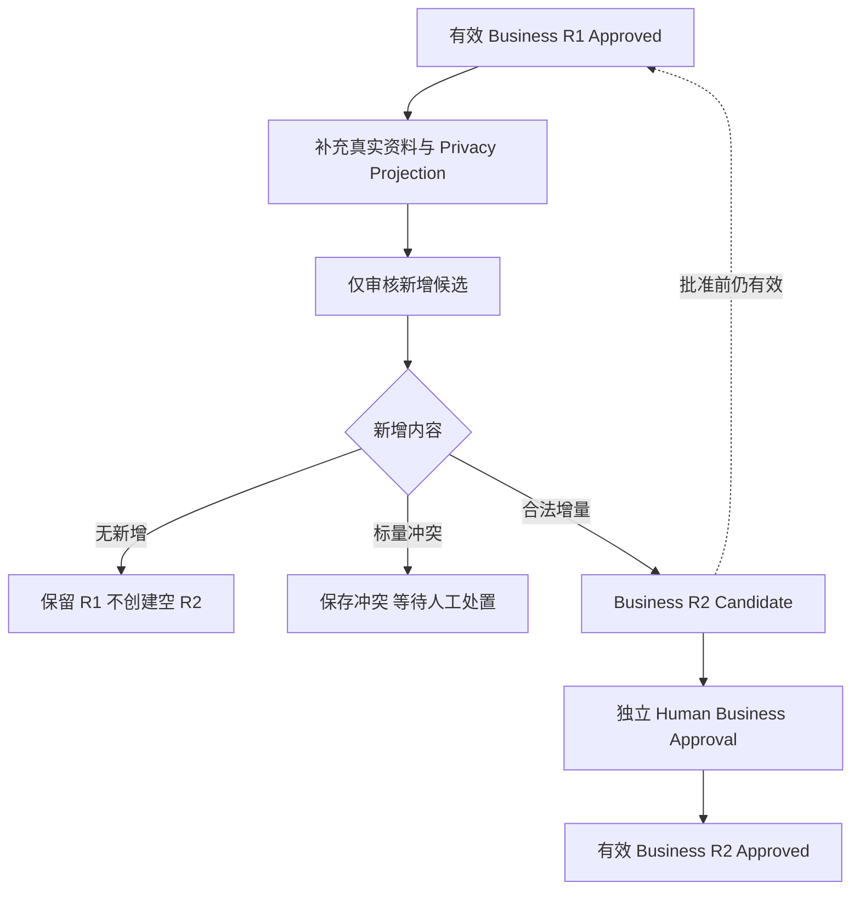

# Customer & Speaker Smart Intake V1.0 Implementation Report

2026-10-09 · CS-0 → CS-3 · Product / Architecture Review Candidate

本轮完成最小录入、稳定客户身份、独立出镜人确认、已批准客户的增量版本修订，以及当前完整前后端的隔离集成验收。结果证明业务编排和离线 Authority 边界；**不代表真实模型质量、4090 Production Validation 或正式产品验收通过**。

## A. Baseline / Worktree

| 项目 | 实际状态 |
|---|---|
| Hostname | `LIJIAN` |
| Frozen baseline / HEAD | `f10f3992433ab81df38ae90f9379ce1061a7afac` |
| 原工作区 | `E:\projects\ai-video-ops`，`main`，tracked diff 为空 |
| 原有未跟踪内容 | 审计报告与 `experiments/` 保留；未 reset、清理或覆盖 |
| 实施工作区 | `E:\cs-intake-v1` |
| 实施分支 | `feature/customer-speaker-smart-intake-v1`，修改尚未提交 |
| 隔离验收节点 | `http://127.0.0.1:18010`；独立数据库及合成 Authority 在 `E:\cs3node` |
| 节点收尾 | `/api/health` 返回 200 / `status: ok`；无 queued/running Task 后关闭；18010 无剩余监听 |
| 生产操作 | 未 commit、push、部署、调用真实模型/Qiyun或操作 4090、云主机、安全组、FRP、Production Authority |

托管 worktree 创建遇到 Windows 长路径限制；使用短路径及单命令 `core.longpaths=true` 建立隔离 worktree。未修改系统长路径策略。Console 与 canonical Pipeline 使用各自正确虚拟环境；两个环境沿用本机已有依赖。

原审计报告按字节复制，SHA 保持 `da0caeedbf42283b97b4eac9742d3a67265afbf21bfe96e6384c0924ed3e544d`；原运行数据库最终 SHA 与实施前一致。[完整性检查](E:/customer-speaker-implementation-20261009/cs3/final-integrity.json)、[健康接口](E:/customer-speaker-implementation-20261009/cs3/final-node-health.json)、[实际进程](E:/customer-speaker-implementation-20261009/cs3/final-listener.json)、[关闭记录](E:/customer-speaker-implementation-20261009/cs3/final-node-stop.json)。最后一次监听 PID `9444`，命令为当前工作区的 `browser_customer_speaker_intake_v1.py --workdir E:\cs3node --port 18010 --resume`，单 ASGI 进程。

## B. Approved Product Decisions Compliance

| 决策 | 实现与验证 |
|---|---|
| 名称＋原始资料即可分析 | 行业可缺省；前后端都检查分析材料非空 |
| 名称-only 可保存 | 可恢复 intake，不创建 Task、不调用模型；后补资料同一 Business ID |
| 出镜人必须明确选择 | 候选默认未选；未选不建 Draft；缺身份独立恢复 |
| Customer / Speaker 独立 Authority | 各自 Fact Review 与 Persona Approval；客户成功不因人物失败撤销 |
| Approved Business 增量修订 | 新增事实独立审核成 R2 Candidate；独立批准前 R1 仍有效 |
| Speaker 显式复核 | 新 Business 批准后旧绑定不匹配；复核与独立 Speaker Approval 后恢复资格 |
| 不扩张授权 | 不授予媒体权利、不转用公司/他人经历、不引入全局 AI 合并或任意 approved fact 编辑器 |

三阶段导航仅为展示分组。SQLite、任务完成和 UI 状态没有成为第二套 Persona Truth。Speaker Gap Supplement 仍一次回答全部当前缺口。

## C. CS-0 Root Cause and HTTP Closure

原故障：Customer Fact Review 已写入后，路由调用不存在的 `speaker-discovery` Operation Lock scope，产生 HTTP 500，用户无法判断是否保存成功。

Customer 步骤在合法 business lock 内保存选择意图、完成 canonical review 和 Task 投影；释放锁后，Speaker 确认单独取得合法 business lock。两个既有操作各自完成，不承诺跨文件原子事务、不嵌套同一把锁。人物失败返回带 `retry_required` 的部分成功，客户审核仍可读。

真实 ASGI、登录、CSRF、gateway、canonical subprocess、operation lock、隔离 SQLite 和 artifact root 的 28 项 focused/integration 检查通过。只注入确定性提取返回及有意的 Draft 存储故障，未替换完整审核链路。[CS-0 JUnit](E:/customer-speaker-implementation-20261009/cs0/final/focused.xml)、[日志](E:/customer-speaker-implementation-20261009/cs0/final/focused.log)。

`CS_0_CUSTOMER_SPEAKER_INTEGRATION_PASS`

## D. CS-0 Recovery and Idempotency

| 问题 | 当前行为 |
|---|---|
| 客户成功、人物失败 | 提示客户已保存；继续添加/重试人物确认；不重提 Customer Review |
| 人物身份缺失 | 保留选中意图，补公开姓名/角色后继续；客户审核不回滚 |
| 确认重放 | 保存每次 intent/result；跳过已建 Draft；相同完成请求复用结果 |
| 人物发现失败 | retry 消费已保存 Privacy Projection，只重跑 discovery；保留原失败文件 |
| Speaker 分析失败 | 复用原 `/speakers/{speaker_id}/analyze`，不要求新建人物 |
| 历史失败遮盖新 Task | 按 type、subject、canonical intake 查询最新创建身份；不用全局最近 100 条或旧 Task 更新时间 |
| 422 空错误框 | 统一解析数组，显示安全业务提示；不显示原 validation input、路径或堆栈 |
| Worker 错误泄漏 | 保留内部 code，前台给中文恢复动作，不投影 subprocess 原始私密消息 |

Customer retry/reanalysis/supplement 的 active-check、request 准备和 Task admission 在 business lock 内。原 Task admission / operation identity 防止并行重复任务；历史 failed Task 保留。两个操作人竞争不可替换已完成审核。人物 retry 复用既有 Customer runner，没有第二套 Worker。

真实浏览器覆盖发现失败、缺身份部分成功、Customer/Speaker retry。文件存储故障、并发和审核重放由真实 ASGI integration tests 覆盖，未误称浏览器故障注入。

## E. CS-1 Minimum Customer Intake

`POST /api/customers/analyze` 当前合同：

| 字段/动作 | 约束 |
|---|---|
| `customer_name` | 必填 1–200 字符；gateway 拒绝纯空白 |
| `materials` | 默认空串、最多 50,000 字符；分析要求非空 |
| `industry` | 可缺省/null，不伪造默认行业 |
| `save_only` | 默认 false；true 仅保存，不启动分析 |
| `submission_key` | 可选 8–64 字符；前端生成并重用一次新建提交身份 |
| `create_separate` | 明确同名不同客户时使用，必须带 submission key |

行业建议复用正式选项，只接受安全材料中存在的引用，非法分类输出丢弃。证据不足不生成候选。原 AI 行业 candidate 可确认/修改/不采用；没有 AI candidate 时，`industry_review` 区分未作判断、人工明确 uncertain、人工确认正式分类。人工分类注明 reviewer、时间和 source，原 AI 文件不改写。

行业不确定不阻止保存客户，未增加 Persona Readiness 硬门槛。Customer Fact Review 不等于 Business Approval。

## F. CS-1 Stable Identity

新客户首次分配 `customer_<uuidhex>`，名称、行业、补充 intake、Task、Speaker、URL、Persona revision 与 Ledger 都沿用该 ID。历史 ID、目录、approved business identity 不迁移。

同名先展示已有客户，不自动合并；允许进入已有客户或明确建立不同客户。同一 submission key 重放复用身份，名称/材料变化拒绝冒充旧提交。补资料使用原 reanalysis/supplement 入口。稳定 ID、历史兼容、同名显式分离、空行业、name-only 无 Task、后补同 ID 均有 ASGI 检查。

## G. CS-1 Business R1→R2 Revision

修复 `ensure_or_build_business_persona` 固定检查 `revision_0001`，使用原 builder、previous approved lineage 和 resolver：



保留旧 approved known facts 和 source refs；新增列表合并去重；早于 Console intake 的 approved 来源也保留。无新增值为 `completed_no_new_facts`。相同提交不产生第二份 R2；准备、审核与批准 business lock 防止并发同号不同候选。

标量冲突在最终 Fact Review 前检查，保存不可变 attempt；运营可明确修改/不采用本次冲突项，不能覆盖原 approved truth。实质纠正仍需受控人工处置。

完整回归发现真实 Windows 路径故障：完整 SHA 文件名加原子临时文件超过上限。改用 SHA 前 24 位文件名，**文件内保存完整 SHA，前缀碰撞 fail closed**；长临时根下 focused 21 项与后续全仓回归通过。[长路径修复验证](E:/customer-speaker-implementation-20261009/cs3/full-failure-repair-2/focused.xml)。

## H. CS-1 Speaker Revalidation

R2 Pending 时 R1 和匹配的 Speaker 仍有效；R2 Approved 后旧 Speaker 投影为 `revalidation_required`，排除当前创作资格。

`POST /api/customers/{business_id}/speakers/{speaker_id}/revalidation/review` 要求登录、CSRF、明确 Human confirmation、精确 Business/Speaker file SHA。UI 展示旧个人事实、新业务信息与表达边界。确认形成未批准 Speaker revision，之后仍需独立“确认出镜人档案”。

`data/speaker_revalidations/<speaker_id>/business_revision_NNNN/` 保存操作人、时间与精确 SHA。重复复核不改候选 SHA；错误 SHA 拒绝。旧 Persona/receipt/Request 不重绑，公司事实不复制为个人经历，不扩张表达或媒体权利。[复核验证](E:/customer-speaker-implementation-20261009/cs3/revalidation-final/console.xml)。

此路径只支持个人事实/边界未变化。个人事实已变化则继续阻塞，要求新证据和人工处理；未增加任意 approved 个人事实编辑器，不能通过勾选“未变化”绕过。

## I. CS-1 Ledger / Historical Authority Integrity

| 不变量 | 证据 |
|---|---|
| R1 Business/Speaker bytes、SHA、receipt 不变 | Trace 1/3 各 10 个保护文件最终再次 hash 一致 |
| 缺口补充旧审核/来源不变 | Trace 2 的 11 个文件一致 |
| 历史 Request/batch/Ledger 不重写 | 隔离 canonical fixture SHA 检查 |
| 新 revision 不重置 Novelty | 同一新 Business ID 通过 canonical append 建立 Mix/News 历史；R2 后 Ledger SHA 和两种重复判断一致 |
| Pending R2 不替代 R1 | Trace 3 current=1、candidate=2，继续使用匹配 R1 的 Speaker |
| 旧 Speaker 不用于新 Business 输入 | binding validation / creation filtering；新批准后旧绑定被排除 |
| Privacy/Rights/Proof/Case Gate 不变 | 原相关 integration 与完整回归通过，Case-specific writer/migration 无 diff |

这些是隔离样本证据，不声称检查全部生产 Request。旧事实实质否定时须现有 Operational Hold/受控人工处置，不暗改历史 lineage。

CS-1 初始 gate Console 41 + Pipeline 41 passed；后续扩展纳入最终回归。[Console](E:/customer-speaker-implementation-20261009/cs1/gate/console.xml)、[Pipeline](E:/customer-speaker-implementation-20261009/cs1/gate/pipeline.xml)。

`CS_1_PERSONA_REVISION_AND_IDENTITY_PASS`

## J. CS-2 New Customer UX

添加客户只突出名称、资料、“开始整理资料”“先保存，稍后补充”。不前置要求行业、价格、经营年限或视频类型；无材料分析在页面提示，不发送空请求。

提交即跳转持久化客户 URL，刷新/关闭重开沿用已有身份和 Task。导航为“提供资料 → AI 自动整理 → 检查并确认”；进度依据真实 Task/artifact，无假耗时或剩余秒数。

审核按“客户是谁 / 主要产品与服务 / 客户通常遇到什么问题 / 真实业务信息 / 重要限制”分组，来源折叠。确认、修改、不采用仍映射原 fact decisions。暖中性色、白卡、深绿主操作沿用内部工作台体系。

## K. CS-2 Speaker Discovery / Review UX

“发现可能的出镜人”展示称呼、资料中角色、依据及必要身份补充，所有“选择为出镜人”默认未选。多候选、无候选、发现失败分别呈现；失败只重试人物发现。

客户未批准可保存人工/发现来源 Draft，记录提交人/时间/来源，提示客户确认后继续本人审核。缺身份不阻塞客户事实。Speaker Review 显示本人职责、亲自经历、允许话题与限制；通用第一人称 guardrail 保留，自定义禁止表达可选。

“确认客户档案”“确认出镜人档案”为独立 Human Gate，没有单按钮自动批准两者。

## L. CS-2 Supplement / Recovery UX

未批准客户只补真实 readiness 缺口，保留已审核事实。已批准客户原无效“编辑”入口转为“补充客户资料”，创建增量 Candidate。R2 Pending 引导继续更新审核；新 Business 已批准/旧 Speaker 未复核引导复核。

双方匹配且批准后显示“去创作”，仍需 Opportunity/Feasibility/Pattern/Case/Novelty 检查，不承诺能生成视频。

移动字段纵排、按钮可点击高度和底部导航安全间距限定 Customer/Speaker 页面。真实浏览器执行滚动、输入、刷新、点击、modal、关闭重开和第二账号登录，不仅截 full-page 图。

## M. CS-3 Integrated End-to-End Results

使用当前完整 ASGI/static、独立 SQLite、正式 migrations、真实 auth/session/CSRF/locks、独立 canonical root 和真实浏览器；未用旧 8000 backend＋新静态文件。

仅远程提取边界注入明确合成输出，串行执行。分析、Privacy Projection、validators、Fact Review、Persona builder/approval、Task admission、lease/reconciler 都使用真实实现，无模型/GPU/Qiyun调用。

| 场景 | 观察结果 |
|---|---|
| name-only 保存/重开/补资料 | 首次无 Task，全程同 ID；Trace 1 |
| 完整首次建档 | 独立审核和双批准，creation entry ready；Trace 1 |
| 资料不足后补缺口 | 仅新增审核，旧审核/来源不变；Trace 2 |
| R1→R2→Speaker 复核 | Pending 保留 R1，新批准阻塞旧 Speaker，独立批准后恢复；Trace 3 |
| 多候选全部不选 | 两候选默认未选，确认后无 Draft，客户继续 |
| 无候选 | 与失败区分，允许手动新增；Trace 2 |
| 发现失败独立重试 | 客户审核保留，12 个原客户 artifact SHA 不变 |
| 缺身份恢复 | 客户成功，后补姓名保存 Draft；Business 尚未批准 |
| Draft 存储失败 | 真实 ASGI 注入 OSError，部分成功/replay 通过；非浏览器注入 |
| Customer failed→retry | 原 subject/intake、新 Task；历史 failed 保留 |
| Speaker failed→retry→批准 | 同 Speaker ID，手机完成本人审核与独立批准 |
| 刷新/重开/第二账号 | 共享状态恢复，原操作者审计保留，无用户私有所有权模型 |
| Worker 实际进程中断 | artifacts 落盘后中断隔离节点，重启由 lease/reconciler 恢复同 Task/intake；8 个 SHA 不变，claimed 一次 |
| 并发/replay/错误 SHA/冲突 | 真实 ASGI tests 验证锁、候选、审批 lineage 和 fail closed |

证据：[场景矩阵](E:/customer-speaker-implementation-20261009/cs3/scenario-matrix.json)、[Speaker 失败](E:/customer-speaker-implementation-20261009/cs3/speaker-failed-before.json)、[重试后审核](E:/customer-speaker-implementation-20261009/cs3/speaker-after-recovery.json)、[恢复后批准](E:/customer-speaker-implementation-20261009/cs3/speaker-recovered-approved.json)、[Worker 中断前](E:/customer-speaker-implementation-20261009/cs3/worker-before-interruption.json)、[恢复后](E:/customer-speaker-implementation-20261009/cs3/worker-after-recovery.json)。

`recover_expired_tasks` 返回值只列重新排队 ID，terminal reconciliation 不返回同样 event；本次依 persisted awaiting_review、同 Task/intake、SHA 和 claimed 次数判断恢复，没有凭缺少 harness event 宣称重复执行。

## N. Migration / Historical Compatibility

**本轮没有 Schema/migration 修改**。001–004 保持基线，004 SHA `c67eff080bde7d24e22ea4d2caeb7778bad06d0bf01ff2b98f8b933105080d59`。

对已填充开发 DB 以 SQLite `mode=ro` online backup 生成安全副本，验证现有 004、重复启动、故意 DDL 故障回滚/恢复与备份恢复。原库不启动本轮应用、不改账号/Session/Task。

| 检查 | 结果 |
|---|---|
| 历史行 | users 1、sessions 1、tasks 42、旧 migrations 3；历史行哈希保持 |
| 应用 004/重复启动 | 检测已应用状态；四个 migration；无重复破坏，行不变 |
| 故障回滚 | 整体事务回滚；失败恢复后可升级 |
| 备份恢复 | backup/upgraded/restored/recovered integrity 均 ok，FK 错误 0 |
| 原库最终 SHA | `ffe5c72fbc16ca8151589875fff815584f1e434df22977b40c28221aa0ca54ea`，与实施前一致 |

[安全副本报告](E:/customer-speaker-implementation-20261009/cs3/compatibility/migration-history-report.json)、[正式 migration auditor](E:/customer-speaker-implementation-20261009/cs3/migration-source-restore/migration-report.json)。含真实账号/Session 的 SQLite 副本不入仓库、不分享，仅报告计数/hash。历史 Persona/receipt/lineage 用隔离 canonical fixtures 验证，与 DB 行兼容性是两层证据，非整套生产副本 E2E。

另一次误将“已应用 004 的副本”传给旧库 auditor 的输入检查失败保留在 `cs3/migration-restore`；正式结论以上述原库只读备份结果为准。

## O. Desktop / Mobile Screenshots

浏览器布局视口 Desktop **1440×1000**、Mobile **390×844**。截图直接来自真实浏览器，未绘制假界面或后期修改。标准调用 `fullPage:false`，API 对部分滚动页面原始 raster 自动返回 1425×990 / 375×812，其余为完整视口尺寸；实际布局以浏览器测量记录为准，不能混同 raster 尺寸。

保留 50 张有效代表截图。[原始尺寸/SHA](E:/customer-speaker-implementation-20261009/cs3/screenshot-dimension-audit.json)、[实际视口/按钮位置](E:/customer-speaker-implementation-20261009/cs3/screenshots/viewport-observations.jsonl)。三张过渡帧/错误 clip 放入 `screenshots/excluded-captures`，不用于 PASS。

| 场景 | 代表截图 |
|---|---|
| 新建 | [桌面](E:/customer-speaker-implementation-20261009/cs3/screenshots/desktop-new.jpg) · [手机](E:/customer-speaker-implementation-20261009/cs3/screenshots/mobile-new.jpg) · [操作区](E:/customer-speaker-implementation-20261009/cs3/screenshots/mobile-new-actions.jpg) |
| name-only | [手机保存](E:/customer-speaker-implementation-20261009/cs3/screenshots/mobile-name-only-saved.jpg) |
| 分析中 | [桌面](E:/customer-speaker-implementation-20261009/cs3/screenshots/desktop-analysis.jpg) · [手机](E:/customer-speaker-implementation-20261009/cs3/screenshots/mobile-analysis.jpg) |
| 客户审核 | [桌面](E:/customer-speaker-implementation-20261009/cs3/screenshots/desktop-customer-review.jpg) · [手机](E:/customer-speaker-implementation-20261009/cs3/screenshots/mobile-customer-review.jpg) |
| 人物发现 | [桌面多候选未选](E:/customer-speaker-implementation-20261009/cs3/screenshots/desktop-multiple-discovery-unselected.jpg) · [手机](E:/customer-speaker-implementation-20261009/cs3/screenshots/mobile-multiple-discovery-unselected.jpg) |
| Draft | [桌面](E:/customer-speaker-implementation-20261009/cs3/screenshots/desktop-speaker-draft.jpg) · [手机](E:/customer-speaker-implementation-20261009/cs3/screenshots/mobile-speaker-draft.jpg) |
| Business Approval | [桌面 modal](E:/customer-speaker-implementation-20261009/cs3/screenshots/desktop-business-approval-modal.jpg) · [手机](E:/customer-speaker-implementation-20261009/cs3/screenshots/mobile-business-approval.jpg) |
| Speaker Review | [手机](E:/customer-speaker-implementation-20261009/cs3/screenshots/mobile-speaker-review.jpg) · [失败恢复后](E:/customer-speaker-implementation-20261009/cs3/screenshots/mobile-speaker-retry-review.jpg) |
| Speaker Approval | [桌面](E:/customer-speaker-implementation-20261009/cs3/screenshots/desktop-speaker-independent-approval-final.jpg) · [手机真实滚动操作](E:/customer-speaker-implementation-20261009/cs3/screenshots/mobile-speaker-approval-safe-action-final.jpg) |
| 资料不足 | [桌面](E:/customer-speaker-implementation-20261009/cs3/screenshots/desktop-needs-more.jpg) · [手机](E:/customer-speaker-implementation-20261009/cs3/screenshots/mobile-needs-more.jpg) · [补缺口](E:/customer-speaker-implementation-20261009/cs3/screenshots/mobile-gap-supplement-action.jpg) |
| Approved 补充 | [手机](E:/customer-speaker-implementation-20261009/cs3/screenshots/mobile-approved-supplement.jpg) · [新增事实](E:/customer-speaker-implementation-20261009/cs3/screenshots/mobile-r2-new-facts.jpg) |
| R2 Pending | [桌面](E:/customer-speaker-implementation-20261009/cs3/screenshots/desktop-r2-pending.jpg) · [手机](E:/customer-speaker-implementation-20261009/cs3/screenshots/mobile-r2-pending.jpg) |
| Speaker Revalidation | [桌面](E:/customer-speaker-implementation-20261009/cs3/screenshots/desktop-speaker-revalidation.jpg) · [手机](E:/customer-speaker-implementation-20261009/cs3/screenshots/mobile-speaker-revalidation.jpg) · [操作区](E:/customer-speaker-implementation-20261009/cs3/screenshots/mobile-speaker-revalidation-action.jpg) |
| 创作入口 | [桌面](E:/customer-speaker-implementation-20261009/cs3/screenshots/desktop-r2-creation-ready.jpg) · [手机最终](E:/customer-speaker-implementation-20261009/cs3/screenshots/mobile-r2-creation-ready-final.jpg) |
| 分析失败/恢复 | [Customer 手机失败](E:/customer-speaker-implementation-20261009/cs3/screenshots/mobile-customer-analysis-failed.jpg) · [Speaker 桌面失败](E:/customer-speaker-implementation-20261009/cs3/screenshots/desktop-speaker-analysis-failed.jpg) · [手机失败](E:/customer-speaker-implementation-20261009/cs3/screenshots/mobile-speaker-analysis-failed.jpg) · [恢复批准](E:/customer-speaker-implementation-20261009/cs3/screenshots/mobile-recovered-speaker-approved.jpg) |
| 部分成功 | [发现失败但客户保留](E:/customer-speaker-implementation-20261009/cs3/screenshots/desktop-discovery-failed-customer-preserved.jpg) · [发现恢复](E:/customer-speaker-implementation-20261009/cs3/screenshots/desktop-discovery-recovered.jpg) · [缺身份](E:/customer-speaker-implementation-20261009/cs3/screenshots/desktop-missing-identity-partial-success.jpg) |
| 共享/Worker恢复 | [第二账号](E:/customer-speaker-implementation-20261009/cs3/screenshots/desktop-shared-customer-second-account.jpg) · [Worker 恢复](E:/customer-speaker-implementation-20261009/cs3/screenshots/desktop-worker-recovered-review.jpg) |

手机最终审批实测：390×844、scroll y=518；按钮 top=553.25、bottom=601.25、高48；导航 top=777，间距175.75。真实点击按钮及 modal 成功，approved API 已保存。不是凭 full-page 图判断无遮挡，未声称实体手机 Safari/软键盘通过。


## P. Full Regression

先 focused，再 integration，最后正式 root route；以下有重叠，不能相加为独立测试总量。

| 检查 | 结果 |
|---|---|
| CS-0 | 28 passed |
| CS-1 初始 Gate | Console 41 + Pipeline 41 passed |
| CS-2 Gate | 43 passed |
| CS-3 Console focused | 49 passed；[JUnit](E:/customer-speaker-implementation-20261009/cs3/final-focused-2/console.xml) |
| Pipeline focused | 67 tests + 40 subtests；[JUnit](E:/customer-speaker-implementation-20261009/cs3/pipeline-focused/pipeline.xml) |
| 最终复核边界 | 19 passed；[JUnit](E:/customer-speaker-implementation-20261009/cs3/revalidation-final/console.xml) |
| 最终错误/cache closure | 12 passed；[JUnit](E:/customer-speaker-implementation-20261009/cs3/final-closure/focused.xml) |
| Python compile / JS syntax | 15 Python / 8 JS/MJS 文件通过 |
| diff check / migration | passed |
| 完整 root regression | **843 passed，0 failures/errors/skips**，包含16个真实前端 JS 文件 |

正式命令（隔离 worktree 根目录）：

```powershell
.\internal-console\.venv\Scripts\python.exe tools\verify.py
```

最终代码 [60689ffe summary](E:/cs-intake-v1/.verify/60689ffe/summary.json) 为 passed，38.139s，`state_unchanged=true`。分项：Pipeline425、Console352、Authority release12、FRP Guard offline30、verifier24。FRP 仅正式 route 离线检查，未开发/配置/部署。

默认排除264项 opt-in live_authority，未计作通过。真实 JS nested result exit0/16files；verifier 自测中故意失败的子运行不是实际 JS 故障。[JS结果](E:/cs-intake-v1/.verify/60689ffe/2/javascript.json)、[静态检查](E:/customer-speaker-implementation-20261009/cs3/static-checks-final.json)。

失败历史 `.verify/dfd1350c` 保留：3个旧 UI 文案/表单断言及真实 Windows 冲突路径故障。按批准交互更新断言和修复路径，未删除 Authority/Rights 断言。随后 `.verify/ce3f973e` 与最终代码 `.verify/60689ffe` 完整通过。报告整理后的交付回归结果保存在 [最终证据目录](E:/customer-speaker-implementation-20261009/cs3/final-regression)。

## Q. Changed Files and Cleanup

tracked修改24个、untracked7个；后者含原样审计副本1个，其余6个为本轮新增测试/报告。无新生产模块、migration或依赖。

| 文件（相对 `E:\cs-intake-v1`） | 责任 |
|---|---|
| `internal-console/app/main.py` | intake合同、独立审核、admission锁、retry/复核路由和状态 |
| `internal-console/app/customer_gateway.py` | 稳定ID/save-only、同名检查、人物恢复、effective revision |
| `internal-console/app/customer_task_service.py` | 原runner discovery-only retry、安全错误 |
| `internal-console/app/speaker_gateway.py` | draft actor、绑定状态、复核适配 |
| `internal-console/app/speaker_task_service.py` | 安全Worker错误 |
| `internal-console/app/task_service.py` | subject/intake当前Task |
| `internal-console/app/content_gateway.py` | 排除旧Business绑定Speaker |
| `ops-pipeline/scripts/customer_onboarding_analysis_v1.py` | 可缺省行业、候选、安全发现retry |
| `ops-pipeline/scripts/customer_fact_review_v1.py` | 人工行业、增量版本、冲突和无新增 |
| `ops-pipeline/scripts/speaker_fact_review_v1.py` | 精确SHA的未变个人证据复核 |
| `internal-console/static/assets/customer-views.js` | 录入/审核/补充/人物/恢复UX |
| `internal-console/static/assets/customer-components.js` | 分组/三阶段/文案 |
| `internal-console/static/assets/speaker-views.js` | 本人审核/继续/复核UX |
| `internal-console/static/assets/speaker-components.js` | 状态和表达边界文案 |
| `internal-console/static/assets/api-client.js` | 安全422业务错误 |
| `internal-console/static/assets/styles.css` | Customer/Speaker移动布局及导航间距 |
| `internal-console/static/assets/app.js` | 当前模块cache版本，保留Case模块版本 |
| `internal-console/static/index.html` | app/style cache版本 |
| `internal-console/tests/test_content_creation_visual_polish_v1.py` | 新文案对应断言，保留边界 |
| `internal-console/tests/test_productization_ui_stage2.py` | 新表单/空输入断言 |
| `internal-console/tests/test_customer_speaker_smart_intake_v1.py`（新增） | CS-0真实ASGI/恢复/锁/actor/错误 |
| `internal-console/tests/test_customer_speaker_revision_v1.py`（新增） | 身份/增量/复核/历史/Ledger/并发 |
| `internal-console/tests/js/customer-speaker-errors.test.mjs`（新增） | 422及路径隐私 |
| `internal-console/tests/js/customer-speaker-smart-ux.test.mjs`（新增） | 文案/默认未选/独立复核/安全区 |
| `internal-console/tests/browser_customer_speaker_intake_v1.py`（新增） | 外部隔离根、单进程合成提取验收，不用于生产 |
| `internal-console/README.md` | 合同及恢复事实入口 |
| `docs/operations/README.md` | 当前契约/writer导航 |
| `docs/operations/AUTHORITY_MAP_V1.md` | 复核artifact边界 |
| `docs/operations/RUNBOOK.md` | 合法操作/恢复 |
| `docs/design/CUSTOMER_SPEAKER_INTAKE_CURRENT_TRUTH_AUDIT.md`（原样复制） | 原Current Truth未改 |
| `docs/design/CUSTOMER_SPEAKER_SMART_INTAKE_V1_IMPLEMENTATION_REPORT.md`（新增） | 本报告/索引 |

全局100-task推导、新客户名称/行业hash、非法lock、固定R1 builder、强制行业页面均原位替换。无应删除的旧生产脚本；原analysis/review/approval/retry/gap API仍被消费，不能删。新增接口只补既有边界，不建立平行Pipeline。

失败证据、旧revision、发现失败文件、历史failed Task与receipt保留。隔离节点关闭，外部合成资料/截图留供评审，后续按Artifact Lifecycle归档，不作为runtime fallback；不自动清理实验目录或安全DB副本。

## R. Known Limitations

1. 未调用真实DeepSeek/Qwen/Whisper/Qiyun，不能判断准确率、人物质量、费用、真实远程隐私效果或延迟；合成仅验证编排/gate。
2. Worker中断为串行合成提取＋真实lease/reconciler；未验证4090 GPU竞争、真实模型进程中断或远程付费幂等。
3. 仅未变个人事实可复核；已批准个人事实实质变化仍须新证据/冲突审核/人工处置，没有任意approved编辑器。
4. 实质否定旧事实须现有Operational Hold/人工处置，未自动扫描暂停所有历史Request。
5. 历史DB行和canonical lineage分层验证，未做4090整套生产备份E2E。
6. Mobile为真实浏览器390×844，未做实体手机Safari/软键盘/横屏/多引擎及极端长文本验收。
7. 同名提示不是全局实体消歧，人物不跨客户自动合并。
8. 去创作只证明档案入口；未生成视频/导出/批准媒体权利，机会和可行性仍可能不足。

未观察到阻塞本轮离线评审的已知回归；以上限制不能用离线PASS替代关闭。

## S. Production Deployment Dependencies

产品/架构验收后，才另行授权commit/push、精确release artifact和4090部署。按现有Local Node/RUNBOOK执行：

1. 冻结包含本轮差异的精确commit，复核Case V1.1与独立Human Gates。
2. 验证正式DB/canonical root备份和恢复；无新migration但旧库仍须正确应用004，生产备份不可省略。
3. 检查单进程、运行中mutation Task和共享GPU；不强杀变更任务，授权窗口内升级完整前后端与正确环境。
4. 用明确授权真实资料受控验证行业/人物质量、Privacy Projection/egress/source、失败恢复，个人事实逐条人工审核。
5. 4090重做三条主轨迹，记录旧Persona/receipt/Request/Ledger SHA，检查旧Speaker不得进入新Business生产输入。
6. 真实健康/权限/备份/模型恢复与人工验收通过前不声明Production PASS，不自动批准真实Persona/媒体权利。

## T. Product Review Verdict Candidate

| Gate / Verdict | 候选结论 |
|---|---|
| CS-0 HTTP/Recovery | PASS，真实隔离ASGI和部分成功恢复 |
| CS-1 Identity/Revision | PASS，旧批准不可变、增量R2、显式Speaker复核与历史不变量 |
| CS-2 UX | READY FOR PRODUCT REVIEW，桌面/手机实际交互和截图 |
| CS-3 Integrated Acceptance | OFFLINE PASS，当前完整代码＋独立DB＋真实auth/CSRF/locks＋合成提取 |
| Authority/Privacy/Human Gates | OFFLINE PASS；真实模型验证待执行 |
| Production Validation/Deployment | NOT RUN / NOT DEPLOYED |
| Product/Architecture Final Review | PENDING HUMAN REVIEW |

工作区差异保留，未提交/推送/部署。以下均为隔离合成资料、明确人工点击的审批，不是真实客户批准。

## Trace 1 — 首次建档、独立双批准、创作入口

Business `customer_d1ab4d73c91b49628ae32fbc4c6776c9`；Speaker `speaker_a008fc7d31e0d0`。

1. 手机名称-only先保存，刷新/关闭重开后同ID补资料；首次无分析Task。
2. 合成资料：“提供宠物洗护。服务附近养宠家庭。先检查毛发再洗护。王琳是店主，亲自接待和洗护并愿意出镜。”行业未前置提供。
3. 原analyzer生成业务/人物候选；人工检查客户事实、行业保留未确定，人物默认未选。
4. Customer Fact Review后独立Business R1 Approval。
5. 明确选择王琳建Draft；分析后人工依据本人来源修改/确认候选，独立Speaker Fact Review和R1 Approval。
6. `creation_entry_ready=true`，第二账号能读共享客户；记录10个旧Persona/receipt等SHA并最终校验。

[批准时投影/SHA](E:/customer-speaker-implementation-20261009/cs3/trace-1-approved.json)、[入口](E:/customer-speaker-implementation-20261009/cs3/screenshots/desktop-creation-ready.jpg)、[第二账号](E:/customer-speaker-implementation-20261009/cs3/screenshots/desktop-shared-customer-second-account.jpg)。Trace3随后推进同客户R2；Trace1保留当时R1状态。

## Trace 2 — 资料不足、仅补缺口、保留旧审核

Business `customer_0f53531f0db5447991c84a5ef55bb8e4`。

1. 仅“提供宠物洗护。”并Human review，行业明确未确定；readiness缺两组能力，不能批准。
2. 记录intake_0001审核/候选/来源/privacy/discovery等11个SHA。
3. 手机补“服务附近养宠家庭。”“先检查毛发再洗护。”，新intake仅新增audience/process候选。
4. 仅审核新增，不重复确认原service；人工行业仍uncertain。
5. 独立Business Approval，旧11个SHA不变。此时没有approved Speaker，入口false，不把客户批准当完整创作资格。

[补前](E:/customer-speaker-implementation-20261009/cs3/trace-2-before.json)、[补充审核批准](E:/customer-speaker-implementation-20261009/cs3/trace-2-approved.json)、[新增事实页](E:/customer-speaker-implementation-20261009/cs3/screenshots/mobile-new-facts-only.jpg)。随后同客户另测Speaker失败/恢复/批准；最终状态不覆盖Trace2当时无Speaker结论。

## Trace 3 — Business R2、Speaker显式复核、恢复资格

沿用Trace1 Business/Speaker ID。

1. 双方R1已批准，保护旧Persona/receipt/来源SHA。
2. 手机补“新增真实流程：先预约，再进行真实皮肤检测。”，仅审核新增process，建立未批准Business R2。
3. Pending时current Business=1、candidate=2，R1匹配Speaker仍有效，入口true。
4. 独立Business R2 Approval后，旧Speaker需复核，入口false，R1未自动重绑。
5. 人工比较旧个人事实与新Business，确认未变化，保存精确SHA复核，创建未批准Speaker R2。
6. 独立Speaker R2 Approval后入口true，第二账号可读，旧保护SHA全部不变。

[Pending](E:/customer-speaker-implementation-20261009/cs3/trace-3-pending-r2.json)、[双方R2批准](E:/customer-speaker-implementation-20261009/cs3/trace-3-approved.json)、[复核页](E:/customer-speaker-implementation-20261009/cs3/screenshots/desktop-speaker-revalidation.jpg)、[最终入口](E:/customer-speaker-implementation-20261009/cs3/screenshots/mobile-r2-creation-ready-final.jpg)。同Business的Mix/News Ledger与novelty另由canonical integration test证明不重置。

`CUSTOMER_SPEAKER_SMART_INTAKE_V1_READY_FOR_PRODUCT_REVIEW`

## 2026-10-10 — 产品验收反馈修复：自动进入审核与人物空结果

### Current Truth / 修复范围

- 修改继续位于 `E:\cs-intake-v1`，冻结 HEAD `f10f3992433ab81df38ae90f9379ce1061a7afac` 未改变；保留之前全部未提交修改。原工作区与原运行数据库未修改。
- 完成页原先只展示进入确认的按钮。现在任务结束后重新读取 Customer 的 canonical 状态并直接展示审核或失败恢复页；只执行 GET，不提交事实决定或 Persona Approval。
- 本机 `18010` 实际是隔离模拟验收节点。旧提取驱动仅认识预置宠物洗护样本，却把任意其他资料返回为空的成功结果。菁禧荟表单中的杜建青因此被遗漏；这不是已经证明的真实 DeepSeek 提取失败。
- 手动验收驱动现在支持这类带明确章节、问题和姓名/品牌关系标签的结构化表单，只复制隐私投影中的原文和来源。个人资料不携带出生年月、性别或公司/其他人物经历；行业不作推断。普通不支持的自由文本明确失败，不再伪装成空结果成功。正式模型提取实现未替换，未新建生产分析流水线。
- 每个隔离验收页面增加明确的“规则模拟解析，不代表真实 AI 分析”提示。提示仅由测试驱动注入同源脚本，保持正式 CSP；正式应用无测试模式开关。
- 原发现结果为空时允许显式“重新查找出镜人”。原分析在 `awaiting_review` 时也可以只重试人物发现；仍沿用同一 operation identity、事务准入和业务锁，重复点击复用运行任务。客户分析重新执行的准入保持原样。

### 原客户恢复结果与不可变边界

Business `customer_d6a5612fcc65442baefd9910ef11b3c0`，恢复 Task `customer-customer_d6a5612fcc65442baefd9910ef11b3c0-750ff6d0d925`。

真实登录、CSRF 和 UI 重试经 canonical 隐私投影、候选校验与不可变 retry artifact 找到 **杜建青 / 菁禧荟创始人**。首次恢复验证时 UI 默认未选。Founder 随后要求默认勾选：未确认人物现在只在 UI 中预选，已有显式取消选择仍保留；不自动建 Speaker Draft。canonical 发现候选的 `default_selected=false` 不改为人工决定；客户仍为 `fact_review_required`，无事实审核或批准。

旧模拟客户业务分析只有名称一项，本次没有改写或替代它，也没有完整恢复客户业务事实。其 8 个原始来源/投影/候选/分析文件 SHA 全部不变。不要依据此旧空结果直接批准客户；完整业务提取仍需后续真实模型验证或按正式补资料流程人工处理，不能手改 Authority 文件补齐。

原运行数据库 SHA256 仍为 `ffe5c72fbc16ca8151589875fff815584f1e434df22977b40c28221aa0ca54ea`。隔离数据库重启前通过 SQLite backup 安全保存至 [before-console.sqlite3](E:/customer-speaker-review-fix-20261010/before-console.sqlite3)。

### 验证与截图

- Focused：8 个 Python 检查覆盖已审核/未审核客户、failed/empty 发现恢复、CSRF、重复点击、保留原 SHA、非空结果复用、多人结构化资料和独立个人经历、正式候选生成无批准、同源模拟提示。前端实际 poller 的 3 种终态验证只读自动转页；失败进入合法恢复页。
- 初次直接 pytest 使用旧 editable 安装路径导致导入原工作区；显式设置本工作区 PYTHONPATH 后纠正。Windows 长临时路径导致发现重试文件创建失败；按正式验证路线使用新短临时根后通过，未改变生产路径策略。
- 真实 Chromium、当前新前后端与独立数据库：新合成表单提交 → 真实 Task → 分析页 → 自动审核页，4 个候选；原客户人物单独恢复成功。没有触发 facts/review、speaker-discovery/confirm 或 persona/approve。
- 后续默认勾选用实际 Renderer 验证首次预选、显式取消与显式选择三种恢复状态；只 GET，不修改候选对象。当前 UI 的默认勾选不自动提交发现确认、人物分析或 Approval。
- 默认勾选补充浏览器证据：[桌面](E:/customer-speaker-review-fix-20261010/default-selected-desktop.png)、[手机](E:/customer-speaker-review-fix-20261010/default-selected-mobile.png)、[真实点击与刷新结果](E:/customer-speaker-review-fix-20261010/default-selected-results.json)。此前截图与 `browser-results.json` 保留默认未选的原验收历史，不作为当前默认值说明。
- Desktop `1280×900`、Mobile `390×844` 的实际 viewport 截图；手机实际展开来源、滚动并检验底部主按钮命中，无横向溢出。浏览器异常为空。
- [浏览器轨迹](E:/customer-speaker-review-fix-20261010/browser-results.json)、[保护文件与原数据库校验](E:/customer-speaker-review-fix-20261010/preservation-results.json)、[可重跑浏览器脚本](E:/customer-speaker-review-fix-20261010/browser-verify.cjs)。脚本包含合成测试流程；重新运行会尝试新的测试提交，不能当只读巡检使用。
- [修复前空结果](E:/customer-speaker-review-fix-20261010/existing-before-person-retry-desktop.png)、[杜建青桌面](E:/customer-speaker-review-fix-20261010/existing-person-recovered-desktop.png)、[杜建青手机](E:/customer-speaker-review-fix-20261010/existing-person-mobile-evidence-open.png)、[分析中](E:/customer-speaker-review-fix-20261010/single-form-running-desktop.png)、[自动审核桌面](E:/customer-speaker-review-fix-20261010/single-form-auto-review-desktop.png)、[自动审核手机](E:/customer-speaker-review-fix-20261010/single-form-auto-review-mobile.png)。
- 最终完整回归经 `python tools/verify.py` 执行；实际结果、日志和本轮最终 diff 保存到 `E:\customer-speaker-review-fix-20261010\final-regression`。仍不包括真实模型、GPU、第三方服务或 Production。

本次修复文件：`app/customer_gateway.py`、`app/customer_task_service.py`、`app/main.py`、`static/assets/customer-views.js`、`tests/browser_customer_speaker_intake_v1.py`、`tests/test_customer_speaker_revision_v1.py`、`tests/test_customer_speaker_smart_intake_v1.py`、`tests/js/customer-speaker-smart-ux.test.mjs` 和本报告（前八项位于 `internal-console`）。没有变更 Schema、冻结案例功能或生产 Authority。

隔离验收节点供继续检查：`http://127.0.0.1:18010`，单进程、禁用正式分析 workers，规则模拟提取。未执行真实模型、未自动批准客户或出镜人、未 commit/push/部署 4090。

## 2026-10-10 — 客户信息解析流程 UI 专项修复

### 根因与界面改动

现有出镜人、补资料区域引用了未定义的 `--space-5` 和 `--brand`。浏览器丢弃相关 padding/颜色声明：桌面出镜人列表、卡片内边距实测为 0，复选框退回浏览器默认色。确认页的业务分组标题与行业字段也缺少容器留白，因此呈现出内容贴边、分区断裂的异常观感。

- 将失效变量改为现有正式间距与深绿色变量；修复后相关列表、卡片、行业字段的桌面内边距均为 24px，勾选颜色为 `rgb(33, 76, 61)`。
- 资料填写、分析中、确认、失败恢复统一阅读宽度、标题和三步导航；资料表单有明确必填标记与足够的文本输入高度。
- 确认页明确客户业务信息、待确认项数、所属行业和出镜人区域；原文、来源依据按需查看，不将缺失信息伪造为已提取事实。
- 没有逐项待审核事实时，显示“请检查行业与出镜人资料”，避免误导性的 0/0；主按钮为“保存确认结果”。原逐项决策和禁用逻辑不变。
- 桌面操作栏放在内容末尾，避免遮挡事实确认按钮；手机操作栏避让底部导航，并为输入与来源展开预留滚动空间。
- 出镜人继续默认勾选，保留既有明确取消选择；不自动保存 Draft 或批准。分析结束自动进入审核的只读行为保持不变。

本轮增量仅涉及 `internal-console/static/assets/customer-views.js`、`styles.css`、`tests/test_productization_ui_stage2.py`、`tests/js/customer-speaker-smart-ux.test.mjs` 和本报告。未修改后端、API、数据库 Schema、案例功能或事实/人物批准规则；之前未提交差异全部保留。

### 验证与证据边界

- Focused：客户 Console、嵌入式人物发现、产品化 UI 共 20 个 Python 检查通过；新增失效设计变量回归后 UI 模块 9 个检查通过。前端 poller、默认预选/取消恢复和失败反馈检查通过。
- 真实 Chromium 对当前完整前后端与独立数据库的两个既有客户进行只读页面验证；实际展开来源、选择行业、切换人物勾选和在页面内编辑/选择事实，未提交审核结果。待确认事实仍须全部决策才能提交。
- 桌面 `1280×900`、手机 `390×844`、窄屏 `320×740` 无横向溢出；实际滚动与命中测试覆盖输入、行业、人物复选框、来源和保存按钮。桌面逐项确认按钮未被操作栏遮挡。
- 分析中、结束自动进入审核、分析失败和人物发现失败采用明确的 GET 响应视觉夹具，未创建真实任务，不作为模型分析或生产任务恢复的通过证据。
- 浏览器错误为空，POST 仅已有账号登录；没有客户事实审核、人物确认或 Persona Approval 请求。本轮未运行真实模型或提交任何业务资料。
- [修复前桌面](E:/customer-intake-ui-polish-20261010/before-populated-desktop.png)、[修复后桌面](E:/customer-intake-ui-polish-20261010/after-populated-desktop.png)、[修复前手机](E:/customer-intake-ui-polish-20261010/before-existing-mobile.png)、[修复后手机](E:/customer-intake-ui-polish-20261010/after-existing-mobile.png)、[手机人物与依据](E:/customer-intake-ui-polish-20261010/after-existing-speaker-mobile.png)。
- [资料填写](E:/customer-intake-ui-polish-20261010/after-new-mobile.png)、[分析中](E:/customer-intake-ui-polish-20261010/after-running-desktop.png)、[失败恢复](E:/customer-intake-ui-polish-20261010/after-failed-desktop.png)、[浏览器结果](E:/customer-intake-ui-polish-20261010/browser-results.json)、[只读浏览器重跑脚本](E:/customer-intake-ui-polish-20261010/browser-verify.cjs)。
- [本轮界面增量 diff](E:/customer-intake-ui-polish-20261010/ui-only.patch)、[数据保护与运行状态校验](E:/customer-intake-ui-polish-20261010/preservation-results.json)。原客户的 10 个 canonical JSON 与原工作区运行数据库按修改前 SHA 校验。
- 最终完整回归使用根目录 `python tools/verify.py` 正式路线；独立证据保存到 [summary.json](E:/customer-intake-ui-polish-20261010/final-regression/summary.json)，结果以该报告为准。此前回归报告不能替代本轮最终验证。

验收服务继续复用 `18010` 原有单进程，静态文件即时生效，无需重启。此节点仍是明确标示的规则模拟隔离验收环境；真实模型提取质量、GPU、外部服务与 4090 Production 未验证。未 commit、push 或部署。
